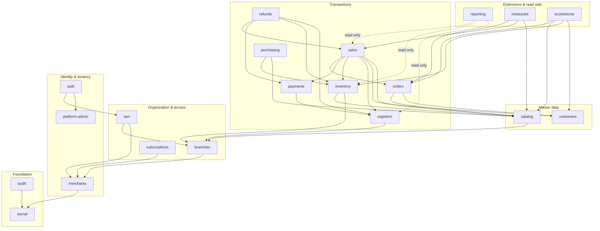

# Architecture

Status: **Implemented** (Prompts 1–17; audited in Prompt 18). Where the original design and
the code differ, the code wins and the differences are listed here:

- Validation uses Zod 4 with a small `ZodPipe` (no `nestjs-zod`, no generated OpenAPI yet).
- No Zustand, TanStack Table, lucide or IndexedDB persistence: state is TanStack Query plus
  React context (e.g. the POS cart), tables are the `DataTable` primitive in `packages/ui`.
- Pricing lives in `packages/money` (`priceCart`); there is no `packages/pricing`.
  Quantities are bigint thousandths (`parseQuantity`), not decimal.js.
- Idempotency keys travel in the request body (`idempotencyKey`), not a header.
- Modules as built: `sales` also owns orders (held carts), `reports` (not "reporting"),
  `transfers`, `subscriptions`, `ecommerce` creates online-channel sales directly
  (ADR-0077). Read-only cross-module SQL is used by several modules (ADR-0083).
- A fourth app, `apps/store-web`, serves the public storefront (ADR-0076).
Related documents: `AUTH.md` (authentication & permissions), `ROUTES.md`
(routing), `DATABASE.md`
(entities & ERD), `DECISIONS.md` (ADRs), `ROADMAP.md` (milestones).

---

## 1. System overview

A multi-tenant POS and Business Management SaaS delivered as a **modular
monolith**: one backend codebase/deployable, one PostgreSQL database, three
separate frontend applications that all call the **same backend business
services** through interface-specific API namespaces.

```
                         ┌──────────────────────────── one HTTPS origin ──────────────────────────┐
  Browser / POS device   │  /manager/*         /pos/*             /platform/*         /api/v1/*   │
                         │  manager-web SPA    pos-web SPA        platform-web SPA    API         │
                         └──────────────────────────────────────────────────────────────┬────────┘
                                                                                        │
   ┌────────────────────────────────────── apps/api (NestJS on Fastify) ────────────────▼────────┐
   │ HTTP adapters (thin):   manager controllers │ pos controllers │ platform controllers │ public │
   │ ─────────────────────────────────────────────────────────────────────────────────────────── │
   │ Guards: authn → realm → interface → merchant context → feature → permission → branch        │
   │ ─────────────────────────────────────────────────────────────────────────────────────────── │
   │ Domain modules (shared services): merchants · branches · iam · catalog · inventory ·        │
   │   sales · orders · payments · registers · refunds · purchasing · customers · reporting ·    │
   │   restaurant · ecommerce · subscriptions · audit                                             │
   │ ─────────────────────────────────────────────────────────────────────────────────────────── │
   │ Platform kernel: database/tx + merchant context (RLS) · money · ids · errors · i18n · clock  │
   └──────────────────────────────────────────────┬──────────────────────────────────────────────┘
                                                  │
                               ┌──────────────────▼──────────────────┐     ┌──────────────────┐
                               │ PostgreSQL 18 (RLS, PITR backups)   │     │ Object storage   │
                               │ + pg-boss job tables (when needed)  │     │ (images, exports)│
                               └─────────────────────────────────────┘     └──────────────────┘
```

Key principle: **controllers are adapters; business logic lives once, in
domain services.** A sale created from the POS, a future e-commerce checkout, or
a restaurant table close all go through the same `SalesService`.

---

## 2. Technology stack (verified 2026-10-11)

Versions were checked against the npm registry, nodejs.org release index and
postgresql.org on 2026-10-11. They are pinned exactly in lockfiles at scaffold
time; minor/patch updates are routine, major upgrades get an ADR.

| Concern | Choice | Version line | Why (short) |
|---|---|---|---|
| Runtime | Node.js LTS | **24.x LTS "Krypton"** | Active LTS. Node 26 is "Current"; move to 26 after it is promoted to LTS. |
| Package manager | pnpm workspaces (via Corepack) | **pnpm 12.x** (latest 12.11), pinned in `packageManager` | Fast, strict dependency isolation, first-class monorepo. |
| Language | TypeScript (strict) | **6.0.x** | TS 7.0 (native compiler) is out, but typescript-eslint supports `<6.1` and NestJS relies on decorator metadata; adopt 7 when the toolchain supports it (ADR-0010). |
| Backend framework | **NestJS + Fastify adapter** | NestJS 12.1, Fastify 5 | Module system + DI + guards map directly onto a modular monolith with layered authorization; Fastify for performance. |
| Validation / contracts | **Zod** (shared schemas) + `nestjs-zod` | Zod 4.x | One schema used by API validation, OpenAPI generation, and frontend forms/clients. |
| ORM / SQL | **Drizzle ORM** + node-postgres (`pg`) | drizzle-orm 0.45.x | Type-safe yet SQL-transparent; essential for RLS, explicit transactions, financial queries. Drizzle 1.0 is RC — adopt when stable. |
| Migrations | **drizzle-kit** generated SQL, hand-reviewed, committed | drizzle-kit 0.31.x | Plain SQL migrations (RLS policies, constraints, triggers are first-class). |
| Database | **PostgreSQL** | **18.x** (current: 18.6) | Current stable major; 19 is beta. Code must also run on 16+ (sandbox CI fallback). |
| Background jobs | **pg-boss** (only when first needed) | 12.x | Queue inside PostgreSQL — no Redis to operate initially. |
| Password hashing | Argon2id (`argon2`) | 0.45.x | Current OWASP recommendation. |
| HTTP security | `@fastify/cookie`, `@fastify/helmet`, `@fastify/rate-limit`, `@fastify/csrf-protection` | latest | Standard hardening. |
| Logging | pino (structured JSON) | 10.x | Fastify-native, fast. |
| Frontend | **React + Vite** | React 19.3, Vite 8.3 | Standard SPA toolchain, fast HMR, simple static output. |
| Routing | **React Router** (data mode, `createBrowserRouter`) | 8.x | Mature, lazy routes, loaders/errors, `basename` per app. |
| Server state | **TanStack Query** | 5.x | Caching, retries, optimistic updates, offline-friendly persistence later. |
| Client state | **Zustand** (only where needed, e.g. POS cart/terminal) | 5.x | Tiny, explicit; no global Redux store. |
| Forms | React Hook Form + Zod resolver | 7.x | Same Zod schemas as backend. |
| Tables | TanStack Table | 9.x | Headless, works with our design system and RTL. |
| UI system | **Tailwind CSS 4 + shadcn/ui pattern on Radix primitives** (`radix-ui`), lucide icons | Tailwind 4.3 | Owned, accessible components; logical CSS properties for RTL. |
| i18n | **i18next + react-i18next**, ICU plurals; `Intl` for numbers/dates | 26.x / 17.x | Arabic/English, namespaces per app. |
| Unit/integration tests | **Vitest** | 5.x | Fast, TS-native, same runner for API and web. |
| API tests | Vitest + Fastify `inject` via Nest testing module | — | No network, real guards. |
| DB tests | Real PostgreSQL 18: dedicated `arabat_test` database (Compose locally, service container in CI) — ADR-0019 | — | RLS and transactions must be tested on the real engine. |
| Component tests | Testing Library + MSW | — | |
| E2E | **Playwright** | 1.64 | Cross-browser, touch emulation for POS. |
| Lint/format | ESLint 10 + typescript-eslint 8.x, Prettier 3 | — | |
| Local env | Docker Compose (`postgres:18`, Mailpit) + pnpm dev servers | — | See §11. |

---

## 3. Repository structure

```
apps/
  api/                    NestJS modular monolith (serves /api/v1/*)
    src/
      kernel/             database, tx, merchant-context, errors, config, clock
      modules/<module>/   one folder per domain module (see §5)
      main.ts
  manager-web/            React SPA, basename /manager
  pos-web/                React SPA, basename /pos
  platform-web/           React SPA, basename /platform
  store-web/              Public storefront SPA, basename /store (no session, ADR-0076)
packages/
  contracts/              Zod request/response schemas, error codes, enums (API ⇄ web)      [M0]
  permissions/            Permission catalog (keys, scope) + can() evaluation              [M0]
  money/                  Money value object: bigint minor units, currencies, rounding      [M0]
  api-client/             Typed fetch client built on `contracts`, ApiError/NetworkError   [M0]
  i18n/                   i18next setup, shared "common" ar/en strings, money formatting   [M0]
  ui/                     Design tokens (theme.css) + accessible primitives, RTL-aware      [M0]
  web-core/               Shared React infrastructure: providers, auth state, guards,      [M0]
                          error/loading states, language switch, API status
  pricing/                Pure pricing functions shared by API (authoritative) and POS     [M4]
docs/
e2e/                      Playwright tests against the built apps (single origin)
docker/postgres/init/     Role/database bootstrap (used by Compose and CI)
```

Rules:
- `packages/*` contain **no I/O and no business persistence** (except
  `api-client` HTTP). Critical calculations (money, pricing) are pure and
  shared, so they are never re-implemented in a frontend.
- Frontend apps never import from `apps/api`; they depend on `contracts`.
- `packages/ui` has no business logic and no API calls.

### 3.1 Frontend app structure (same in all three apps)

Manager app as implemented (Prompt 6): `src/app` (branch context, navigation config),
`src/layouts/ManagerLayout.tsx`, `src/features/<module>/…Page.tsx`, `src/routes.tsx`.
Shared building blocks: `@arabat/ui` (Button, Field, Input, Select, Checkbox, Textarea,
Dialog, ConfirmDialog, Menu, Tabs, DataTable, PageHeader, Section, StatCard, Toast)
and `@arabat/web-core` (AppRoot, auth state, guards, auth forms, `useNotify`).


```
src/
  app/          router.tsx, providers (QueryClient, i18n, theme, auth), layout shell
  features/     <feature>/ { routes.tsx, pages/, components/, api.ts (query hooks), model.ts }
  shared/       app-local hooks, utils, guards (RequirePermission)
  main.tsx
```

Each app has its **own layout, navigation and workflows** (ADR-0001):

| App | Layout | Optimized for |
|---|---|---|
| manager-web | Sidebar + top bar, data tables, forms, reports | Desktop / tablet, mouse & keyboard |
| pos-web | Full-screen register: product grid + cart + pay panel; no sidebar | Touch, barcode scanner, speed |
| platform-web | Dense admin console | Desktop, operator staff |

---

## 4. Application boundaries

### 4.1 `/manager` — Manager Dashboard
- Users: merchant owner, and members whose roles grant `manager.access` at
  ≥1 branch (managers, accountants, inventory staff with explicit permission).
- Branch-aware: a branch switcher shows only accessible branches; "All
  branches" only for users with merchant-wide access.
- Feature-flagged sections (restaurant, e-commerce) appear only if the
  merchant's subscription includes them.

### 4.2 `/pos` — Employee POS
- Users: members with `pos.access` at the selected branch (cashiers, waiters,
  and managers **only if explicitly granted**).
- Workflow: login → select branch & register → open shift (opening float) →
  sell → (hold/recall, refund, cash in/out) → close shift (count, variance).
- Performance design:
  - Catalog for the active branch (products, barcodes, prices) is loaded once
    and cached (TanStack Query, persisted to IndexedDB); barcode lookup is a
    local map lookup — no request per scan.
  - Barcode scanners in keyboard-wedge mode are captured by a global input
    buffer (fast keystroke burst + Enter) independent of focus.
  - Totals are previewed instantly in the client with `packages/pricing`; the
    server recomputes with the same code and is **authoritative**.
  - Touch: ≥44px hit targets, no hover-only UI, numeric keypad component.
  - Every write carries an `Idempotency-Key`; a retried "Pay" never duplicates
    a sale.
- Sensitive actions (void, refund, discount above limit, price override,
  no-sale drawer open) require their own permission or a **manager override**
  (see `AUTH.md` §7).
- Offline selling is **not** in scope until OQ-005 is decided; the design
  (idempotency keys, client-generated UUIDv7 ids, local catalog cache) keeps
  that door open.

### 4.3 `/platform` — Platform Administration
- Users: platform operators only (separate identity realm, MFA mandatory).
- Merchant lifecycle (create/suspend/reactivate), plans & subscriptions,
  operator accounts, platform audit, system health.
- Operators never appear as merchant members. Any future support access to a
  merchant's data is explicit, time-boxed, reason-logged and audited.
- Recommended production hardening: separate hostname and IP allowlist
  (deployment decision, requires approval).

### 4.4 Shared backend services
Each domain module exposes services; each interface has its own thin
controllers that call them:

```
modules/sales/
  domain/            entities, value objects, invariants (pure)
  application/       SalesService, RefundPolicy… (use cases, transactions)
  infrastructure/    Drizzle schema + repositories
  http/
    pos.controller.ts        → /api/v1/pos/sales…
    manager.controller.ts    → /api/v1/manager/sales…
  sales.module.ts            exports SalesService
```

---

## 5. Domain modules

### 5.1 Module catalogue

| # | Module | Owns (tables) | Responsibility | Interfaces |
|---|---|---|---|---|
| K | **kernel** | — | DB connection, `withMerchantTx()`, RLS context, ids (UUIDv7), errors, config, clock | — |
| 1 | **audit** | `audit_log` | Append-only audit of security & financial events | M (view), P |
| 2 | **auth** | `sessions`, `password_reset_tokens`, `mfa_factors`, `login_attempts` | Login/logout, sessions, password reset, MFA, overrides | M, POS, P |
| 3 | **merchants** | `merchants`, `merchant_settings` | Merchant (tenant) profile, settings (currency, timezone, default language) | M (own), P |
| 4 | **branches** | `branches` | Branches of a merchant | M |
| 5 | **iam** (users & permissions) | `users`, `memberships`, `roles`, `role_permissions`, `role_assignments`, `invitations` | Merchant users, roles, branch-scoped assignments, permission evaluation | M |
| 6 | **platform-admin** | `platform_operators`, `platform_roles` | Operator identities and their permissions | P |
| 7 | **subscriptions** | `plans`, `plan_features`, `subscriptions` | Plans, merchant subscription, feature entitlements & limits (no live billing without approval) | P, M (view) |
| 8 | **catalog** (products) | `categories`, `products`, `product_variants`, `product_barcodes`, `branch_prices`, `tax_rates` | Products, variants, barcodes, prices | M, POS (read) |
| 9 | **customers** | `customers` | Customer records (loyalty later) | M, POS |
| 10 | **inventory** | `stock_movements`, `stock_levels`, `stock_adjustments`, `stock_transfers` | Append-only stock ledger and balances per branch | M, POS (read) |
| 11 | **registers** (registers & shifts) | `registers`, `shifts`, `cash_movements` | Registers per branch, shift open/close, cash in/out, counts & variance | M, POS |
| 12 | **payments** | `payment_methods`, `payments` | Tender recording (cash, card-manual, …); gateway adapters later with approval | M, POS |
| 13 | **orders** | `orders`, `order_lines` | Non-final documents: held/parked carts, open tabs, restaurant & online orders, fulfilment status | POS, M |
| 14 | **sales** | `sales`, `sale_lines`, `sale_line_taxes`, `receipt_sequences` | Final, immutable financial transactions; numbering; receipts | POS, M |
| 15 | **refunds** | `refunds`, `refund_lines` | Returns/refunds against sales with limits & restock | POS, M |
| 16 | **purchasing** | `suppliers`, `purchase_orders`, `purchase_order_lines`, `goods_receipts`, `goods_receipt_lines` | Suppliers, POs, receiving into stock, cost | M |
| 17 | **reporting** | read models (e.g. `daily_sales_summary`) | Read-only queries & summaries | M, P (platform metrics) |
| 18 | **restaurant** | `dining_areas`, `dining_tables`, `modifier_groups`, `modifiers`, `kitchen_tickets` | Tables, modifiers, kitchen tickets; uses orders/sales | POS, M |
| 19 | **ecommerce** | `online_stores`, `channel_listings` | Online storefront channel; creates orders via orders module | M (+ public API later) |
| 20 | **assistant** | — (stateless) | Read-only chat helper on the register over the catalog, inventory, sales and shift services; provider behind `AssistantModel` (ADR-0105) | POS |

M = /manager, POS = /pos, P = /platform.

### 5.2 Orders vs Sales vs Refunds
- **Order** = intent / fulfilment document that can change (held cart, open
  table tab, online order). It has no financial effect.
- **Sale** = the **final, immutable** financial transaction (invoice). It is
  created atomically with its payments and stock movements. A POS quick sale
  creates a sale directly; an order is converted into a sale when paid/closed.
- **Refund** = a new immutable document referencing an original sale's lines;
  never edits the sale. Refundable quantity/amount is tracked per line.
- **Void** = cancellation of a sale within the same open shift, recorded as a
  compensating document (not a delete).

### 5.3 Module dependency overview

Dependencies point **downwards only** (no cycles). A module may call another
module only through its exported service — never its tables.



Cross-cutting: every module may use `kernel` and `audit`. Guards use `auth`,
`iam`, `subscriptions` (feature entitlements).

### 5.4 Consistency rules between modules
- Critical side effects run **synchronously in the same DB transaction**: e.g.
  `SalesService.complete()` writes sale + lines + payments + stock movements +
  cash movement in one `withMerchantTx`.
- Non-critical side effects (summary refresh, notifications, webhooks later)
  use in-process domain events, and a **transactional outbox** + pg-boss once
  we need async delivery.
- Reporting reads via SQL views/read models; it never writes business tables.

---

## 6. Core relationships (merchant · user · membership · role · branch)

```
User (global identity: email, password)
  └─< Membership (user ↔ merchant; is_owner; status; preferred language)
        └─< RoleAssignment (role, branch_id | NULL = all branches)
                 └── Role (per merchant; set of permission keys)
Merchant ─< Branch
Merchant ─< Role
```

- One **user** may be a member of several merchants (e.g. an accountant); at
  login they pick the merchant if more than one.
- Exactly **one owner membership** per merchant (`is_owner`, partial unique
  index). The owner implicitly holds every permission at every branch.
- **Branch-level access control:** a role assignment is either merchant-wide
  (`branch_id IS NULL`) or limited to one branch. A user can be *Manager* at
  branch A and *Cashier* at branch B. A user's accessible branches = branches
  where they have any assignment (all, if merchant-wide or owner).
- Details: `AUTH.md`. Entity design: `DATABASE.md`.

---

## 7. API architecture

- **REST + JSON** over HTTPS, versioned under `/api/v1`. (GraphQL/tRPC rejected:
  REST suits three clients, future e-commerce/public APIs, idempotency and HTTP
  caching — ADR-0012.)
- Namespaces enforce the interface boundary:
  | Prefix | Realm | Required |
  |---|---|---|
  | `/api/v1/manager/...` | merchant | session for `manager` + `manager.access` |
  | `/api/v1/pos/...` | merchant | session for `pos` + `pos.access` + bound branch |
  | `/api/v1/platform/...` | platform | operator session (MFA) |
  | `/api/v1/auth/...` | — | public auth endpoints per interface |
  | `/api/v1/public/...` | — | future e-commerce storefront (not in scope) |
- Contracts: Zod schemas in `packages/contracts`; OpenAPI 3.1 document generated
  for documentation and external clients.
- Errors: RFC 9457 `application/problem+json` with stable `code`
  (e.g. `INSUFFICIENT_STOCK`), localized `title` via `Accept-Language`.
- Money in JSON: **string decimal + currency**, e.g.
  `{ "amount": "1.250", "currency": "KWD" }` — never JSON numbers.
- Lists: cursor pagination (`?cursor=&limit=`), explicit filters, stable sort.
- Writes: `Idempotency-Key` header required on POS financial writes; stored
  per merchant with response replay.
- Concurrency: `version` field on editable master data → `409 Conflict` on stale update.
- Ids: UUIDv7 generated server-side (client-generated allowed for POS documents
  to support retries and future offline mode).

---

## 8. Internationalization, RTL/LTR and localization

- **Languages:** Arabic (`ar`, RTL) and English (`en`, LTR) for all three apps
  (confirmed requirement BR-016). Default language per merchant; per-user
  preference overrides; POS can switch language instantly.
- **Direction:** `<html lang dir>` set from active language. All styling uses
  **logical properties** (Tailwind `ms-*`, `me-*`, `ps-*`, `pe-*`, `start-*`,
  `end-*`, `text-start`); directional icons flip via a `dir`-aware wrapper.
  Lint rule forbids physical `ml-/mr-/pl-/pr-/left-/right-` classes.
- **Fonts:** an Arabic-capable family (e.g. IBM Plex Sans Arabic) + Latin
  pairing, self-hosted (no external font CDN at runtime).
- **Numbers & money:** formatted with `Intl.NumberFormat`; KWD always 3 decimals.
  Digit style (Latin `0-9` vs Arabic-Indic `٠-٩`) is a merchant setting,
  default Latin (OQ-012).
- **Dates/time:** stored in UTC; displayed in the branch timezone
  (default `Asia/Kuwait`); Gregorian calendar.
- **Bilingual master data:** user-facing names that appear on receipts
  (products, categories, branches, payment methods) have `name_en` and
  `name_ar` columns (at least one required). Receipts can print both.
- **Translations:** i18next namespaces: `common` (shared package), plus one per
  app feature; keys in English; missing-key check in CI.
- **Server messages:** errors carry codes; the API localizes `title`, the
  frontend may localize by code.

---

## 9. Financial precision (KWD)

- Money = `bigint` minor units + ISO 4217 currency; KWD exponent 3 (fils).
- `packages/money`: immutable `Money` over `bigint`; add/subtract/multiply by
  quantity (decimal) and percentage with **explicit rounding mode**; allocation
  that never loses a fils (largest-remainder).
- Quantities use exact decimals (`numeric(18,3)` in DB, decimal.js in TS).
- Rounding rule BR-033 (half-up per line, then sum) is implemented once in
  `packages/pricing` and covered by exhaustive tests.
- No `number` arithmetic on money anywhere; lint rule bans `parseFloat` /
  `Number()` on money fields in API and web code.

---

## 10. Security architecture (summary)

Full design in `AUTH.md`.
- Centralized `AuthService`; opaque session tokens in `HttpOnly` cookies,
  separate cookie per interface, server-side sessions (instant revocation).
- Guard chain on every route; **default deny**.
- Merchant id from session only → `SET LOCAL app.merchant_id` → PostgreSQL RLS.
- Branch scope enforced in guards *and* in queries.
- Rate limiting on auth endpoints; lockout/backoff; Argon2id; CSRF protection;
  strict CSP via helmet; secrets only via environment.
- Audit log for logins, permission changes, overrides, voids, refunds, cash
  movements, price changes, settings.

---

## 11. Local development environment

- Requirements: Node.js 24 LTS (`.nvmrc`), Corepack-enabled pnpm, Docker.
- `docker compose up` → `postgres:18` (port 5432, separate `app_owner` /
  `app_runtime` roles and `arabat_dev` / `arabat_test` databases created by
  `docker/postgres/init`). Mailpit (local e-mail capture) is added in M1 when the
  first e-mail (invitations) exists.
- `pnpm dev` runs: API (`:3000`), manager-web (`:5173`, base `/manager`),
  pos-web (`:5174`, base `/pos`), platform-web (`:5175`, base `/platform`), store-web (`:5176`, base `/store`).
  Each Vite dev server proxies `/api` to the API (cookies are host-scoped, so the
  ports share sessions on `localhost`). For a single-origin run use
  `pnpm build && SERVE_WEB=true pnpm start` (ADR-0021).
- `pnpm db:migrate`, `pnpm db:seed` (reference data now; demo merchant, branches,
  roles and users are added in M1 and never run in production).
- Startup procedure: `README.md`.
- `.env.example` documents all variables; real `.env` is git-ignored.
- CI (`.github/workflows/ci.yml`) runs on PostgreSQL 18 with the same init script.

---

## 12. Deployment architecture (design only — no deployment without approval)

```
Internet ─► CDN / TLS edge ─► Load balancer / reverse proxy
                                 ├─ /manager, /pos, /platform → static SPA assets (immutable, hashed)
                                 └─ /api/*                     → API containers (N, stateless)
                                                                  ├─ worker container(s) (same image, pg-boss)
                                                                  ├─ Managed PostgreSQL 18 (HA, PITR, encrypted)
                                                                  └─ Object storage (images, exports)
```

- One Docker image (multi-stage, non-root) for API and worker; SPAs built to
  static assets (served by CDN or the proxy).
- Environments: `local` → `staging` → `production`; migrations run as a
  separate release step before new API instances start (expand/contract for
  zero-downtime).
- Observability: structured logs, request ids, health/readiness endpoints,
  OpenTelemetry-compatible metrics/tracing, error tracking.
- Backups: PITR + daily snapshots; restore tested periodically.
- CI (GitHub Actions): lint, typecheck, unit, integration (PostgreSQL service),
  E2E, build. CD only after owner approval of a hosting provider (OQ-011).
- Cloud provider and region: **Google Cloud, Doha (`me-central1`)** — Cloud Run, Cloud SQL
  PostgreSQL 18, Cloud Storage, external load balancer (ADR-0105, OPERATIONS.md §9; prepared,
  not created). Staging stays on Railway (ADR-0087).

---

## 13. Scalability path (do not build ahead of need)

1. Stateless API → horizontal scaling behind the load balancer.
2. PgBouncer (transaction pooling is compatible with `SET LOCAL`).
3. Indexes lead with `merchant_id`; hot tables (`sales`, `sale_lines`,
   `stock_movements`, `audit_log`) designed to allow time-range partitioning.
4. Read replica for reporting; pre-aggregated summaries.
5. Extracting a module into a service is possible because modules talk only
   through service interfaces — but only with measured need (ADR-0003).

---

## 14. Explicit non-goals for now
- Microservices, message brokers, Redis, GraphQL.
- Offline POS (pending OQ-005).
- Live payment gateways / card terminals (requires approval; OQ-013).
- Native mobile apps (POS runs in browser/PWA-capable SPA).
- Automated deployment (requires approval).
