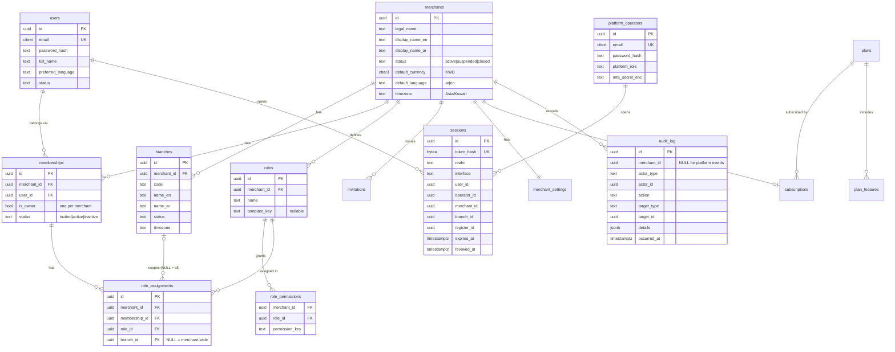
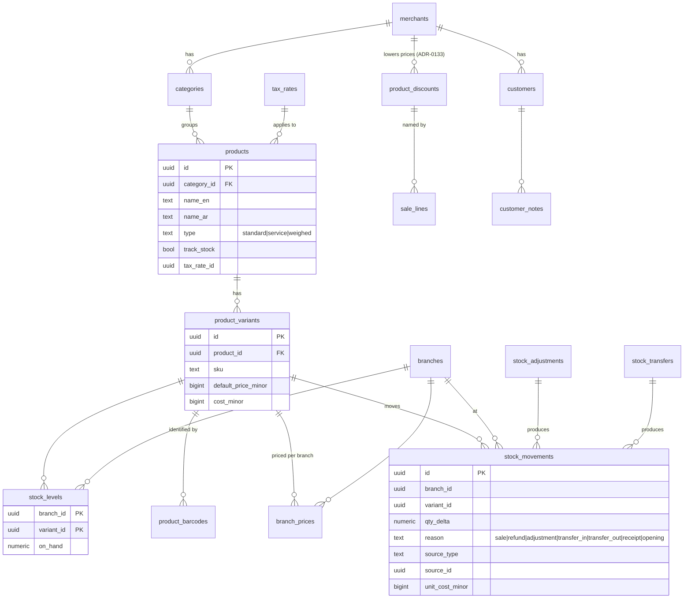
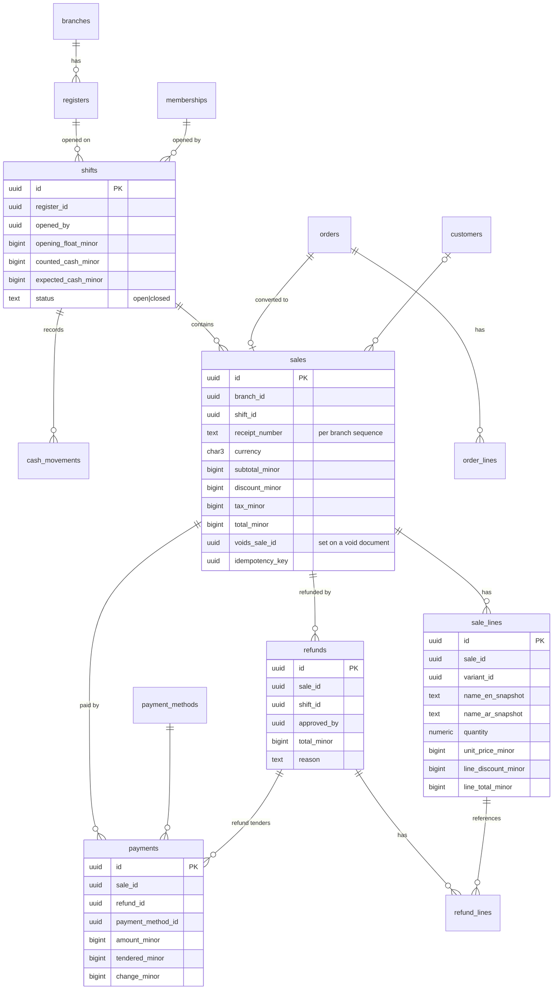

# Database

Status: **Implemented** — 74 migrations (`0000`–`0073`, §8); RLS on every merchant table.
The tenant is called **merchant** in the schema (`merchant_id`).

---

## 1. Engine and access
- PostgreSQL **18.x** in all environments (local Docker image `postgres:18`, CI
  service `postgres:18`). UUIDv7 is generated in the application.
- Access via Drizzle ORM + node-postgres. Schema changes **only** through
  versioned SQL migrations in the repo (drizzle-kit generate → hand review).
- Roles:
  - `app_owner` — owns schema objects and every table, runs migrations; no superuser, no
    `BYPASSRLS` (Cloud SQL never grants it, ADR-0105): exempt from RLS only as table owner.
  - `app_runtime` — used by the API: DML only, **no superuser, no `BYPASSRLS`**.

## 2. Naming & column conventions
- `snake_case`, plural table names.
- PK `id uuid` (UUIDv7, time-ordered → index-friendly).
- FK `<entity>_id`; merchant-owned children use composite FKs
  `(merchant_id, <entity>_id) → parent(merchant_id, id)`; every merchant table
  has `unique (merchant_id, id)` to support this.
- `created_at timestamptz not null default now()`, `updated_at` on mutable rows,
  `created_by` / `updated_by` (membership or operator id) where relevant.
- `version int not null default 1` on editable master data (optimistic locking).
- Status enums as `text` + `check` constraints (easier migrations than PG enums).
- Bilingual display names: `name_en text`, `name_ar text`,
  `check (coalesce(name_en, name_ar) is not null)`.

## 3. Multi-tenancy
- Every merchant-owned table: `merchant_id uuid not null`.
- RLS on every such table:
  ```sql
  alter table <t> enable row level security;
  create policy merchant_isolation on <t>
    using (merchant_id = app_current_merchant_id())
    with check (merchant_id = app_current_merchant_id());
  ```
  `app.merchant_id` is set per transaction with `SET LOCAL` by the kernel's
  `withMerchantTx()`. When it is unset, no rows are visible.
- Unique business keys are scoped: `unique (merchant_id, sku)` etc.
- Global tables (no RLS, accessed only by specific modules): `users`,
  `sessions`, `platform_operators`, `plans`, `currencies`.
  `merchants` itself is readable through a policy on `id = app.merchant_id` and
  through the platform module's audited path.

## 4. Money, quantities, rates
- Money: `bigint` minor units + `currency char(3)`. KWD = 3 decimals
  (1.250 KWD → `1250`). Columns suffixed `_minor` (e.g. `total_minor`).
- Forbidden types for money: `real`, `double precision`, `money`. Money is never
  converted to a JS `number`.
- `currencies (code, exponent, name_en, name_ar)` reference table (KWD=3).
- Quantities: `numeric(14,3)`; handled in TS as bigint thousandths (`parseQuantity` in
  `packages/money`, e.g. `2.5` → `2500n`), never as `number` and not with decimal.js.
- Rates: `numeric(9,6)` as a fraction (e.g. `0.050000` = 5%) or basis points —
  documented per column.

## 5. Append-only rules
- Insert-only tables: `sales`, `sale_lines`, `payments`,
  `refunds`, `refund_lines`, `stock_movements`, `cash_movements`,
  `audit_log`, `goods_receipt_lines`.
- Enforced by: no UPDATE/DELETE grants for `app_runtime` on these tables
  (status columns that must change, e.g. `sales.status = voided`, are avoided by
  storing voids as separate rows referencing the sale).
- `stock_levels` is a cached balance updated in the **same transaction** as the
  movement; it can always be rebuilt from `stock_movements`.

## 6. Entity relationship design

### 6.1 Identity, organization and access (Milestone M1)



Key constraints:
- `unique (merchant_id, user_id)` on memberships;
  `unique (merchant_id) where is_owner` (exactly one owner, enforced together
  with creation logic).
- `unique (merchant_id, name)` on roles; `unique (membership_id, role_id, branch_id)`
  with `NULLS NOT DISTINCT` semantics for assignments.
- `unique (merchant_id, code)` on branches.

### 6.2 Catalog, inventory, customers (M2–M3)



Every product has at least one variant (simple products have exactly one), so
sales, stock and prices always reference `product_variants`.

### 6.3 Registers, shifts, orders, sales, payments, refunds (M4–M5)



- Sale lines **snapshot** names, prices and tax so historic receipts never
  change when the catalog changes.
- Receipt numbers: gap-free per branch via `receipt_sequences`
  (row lock in the sale transaction).
- `sales.idempotency_key` unique per merchant.
- Cash custody (ADR-0090): registers and branch treasuries are `financial_accounts` rows; their
  balance is the sum of their `financial_account_entries`. Cash payments and cash refunds post to
  the register with the shift id; `cash_transfers` move cash between a register and its branch
  treasury as one balanced pair. All cash postings go through `apps/api/src/modules/payments/cash-ledger.ts`
  and lock the shift row first, then the accounts in id order.
- Phase B (ADR-0091): `cash_disbursements` are real outflows with one `expense` /
  `supplier_payment` entry each; bank deposits and branch transfers are `cash_transfers`; cash
  between branches sits in the merchant's single `in_transit` account.

### 6.4 Later modules (entities only; designed in detail when scheduled)
| Module | Entities |
|---|---|
| purchasing | implemented (Prompt 12) — see §8 |
| restaurant | implemented (Prompt 15) — see §8 |
| ecommerce | implemented (Prompt 16) — see §8 |
| reporting | implemented on demand from source tables (ADR-0068); summary tables only if volumes require |
| subscriptions | implemented (Prompt 17) — see §8 |
| assistant | implemented (ADR-0107) — `assistant_requests`, platform-owned usage record, see §8 |
| idempotency | `idempotency_keys (merchant_id, key, request_hash, response, expires_at)` |
| outbox | `outbox_events` (when async delivery is first needed) |

## 7. Indexing guidelines
- Every merchant table: indexes lead with `merchant_id`.
- Time-series tables (`sales`, `stock_movements`, `audit_log`):
  `(merchant_id, branch_id, created_at desc)`; designed so time partitioning
  can be added without changing application code.
- Barcode lookup: `unique (merchant_id, barcode)`.

## 8. Implemented migrations

| File | Content |
|---|---|
| `apps/api/drizzle/0000_bootstrap.sql` | `GRANT USAGE` on schema to `app_runtime`; default privileges (DML on tables, sequences, functions) for objects created by `app_owner`; function `app_current_merchant_id()` (NULL when unset) for RLS policies |
| `apps/api/drizzle/0001_currencies.sql` | `currencies` reference table (code, exponent, `name_en`, `name_ar`); `app_runtime` is read-only on it |
| `apps/api/drizzle/0002_identity.sql` | `merchants`, `branches`, `users`, `memberships`, `roles`, `role_permissions`, `role_assignments`, `sessions`, `auth_tickets`, `password_reset_tokens`, `rate_limit_buckets`, `platform_operators`, `audit_log` (generated) |
| `apps/api/drizzle/0003_identity_rls.sql` | `app_current_user_id()`; RLS (forced at the time; not forced since 0048) on merchants, memberships, branches, roles, role_permissions, role_assignments, audit_log; `DELETE` revoked on merchants; `UPDATE/DELETE` revoked on audit_log; lookup indexes |

| `apps/api/drizzle/0004_employees.sql` | `invitations`, `invitation_assignments`; branch settings (`phone`, `address`, `receipt_header`, `receipt_footer`); employee profile on memberships (`job_title`, `phone`, `employee_code`) |
| `apps/api/drizzle/0005_employees_rls.sql` | `app_current_invite_hash()`; RLS on invitations (merchant context or matching invite token hash) and invitation_assignments; data migration of renamed permission keys and `manager` → `company_manager` |

| `apps/api/drizzle/0006_catalog.sql` | `categories` (self-referencing tree), `products`, `product_variants` (`price_minor`/`cost_minor` bigint, currency), `product_barcodes`, `product_branch_availability`, `product_images` |
| `apps/api/drizzle/0007_catalog_rls.sql` | RLS (forced until 0048) on all catalog tables; `DELETE` revoked on products and variants (archive only); `pg_trgm` + trigram indexes on names and SKU |

| `apps/api/drizzle/0008_inventory.sql` | `inventory_settings`, `stock_levels`, `stock_adjustments`, `stock_adjustment_lines`, `stock_movements` (generated) |
| `apps/api/drizzle/0009_inventory_rls.sql` | RLS (forced until 0048) on all inventory tables; `UPDATE/DELETE` revoked on the ledger and adjustment documents; `DELETE` revoked on `stock_levels` |

| `apps/api/drizzle/0010_payments_registers.sql` | `financial_accounts`, `financial_account_entries`, `payment_methods`, `registers`, `register_members`, `shifts`, `cash_movements` (generated) |
| `apps/api/drizzle/0011_payments_registers_rls.sql` | RLS (forced until 0048); append-only grants on entries and cash movements; no deletes of configuration; trigger making closed shifts immutable; trigger allowing cash movements only on open shifts |
| `apps/api/drizzle/0012_shift_tolerance.sql` | `shifts.discrepancy_tolerance_minor` (tolerance snapshot at closing) |

| `apps/api/drizzle/0013_sales.sql` | `sales_settings`, `receipt_sequences`, `orders`, `order_lines`, `sales`, `sale_lines`, `payments` (generated) |
| `apps/api/drizzle/0014_sales_rls.sql` | RLS (forced until 0048); `UPDATE/DELETE` revoked on sales, sale lines and payments; triggers making completed/cancelled orders and their lines final |

| `apps/api/drizzle/0015_refunds.sql` | `refunds`, `refund_lines`, `refund_payments`; refund policy columns on `sales_settings`; `payments.refund_id` + nullable method for exchange credit (generated) |
| `apps/api/drizzle/0016_refunds_rls.sql` | RLS (forced until 0048); no deletes; refund lines immutable; triggers: final refund states immutable, only pending refund payments may settle |
| `apps/api/drizzle/0017_refund_zero_total.sql` | Allow zero-value refunds (returning free items to stock) |

| `apps/api/drizzle/0018_purchasing_transfers.sql` | `document_sequences`, `suppliers`, `purchase_orders`, `purchase_order_lines`, `purchase_receipts`, `purchase_receipt_lines`, `stock_transfers`, `stock_transfer_lines` (generated) |
| `apps/api/drizzle/0019_purchasing_transfers_rls.sql` | RLS (forced until 0048); no deletes; receipts append-only; triggers: order lines editable only while draft, final order/transfer states immutable, transfer line quantities set once |
| `apps/api/drizzle/0020_customers.sql` | `customers`, `customer_notes`; `orders.customer_id`, `sales.customer_id` with composite merchant FKs and `sales_customer_idx` (generated) |
| `apps/api/drizzle/0021_customers_rls.sql` | RLS (forced until 0048); `DELETE` revoked on customers; notes append-only; trigram indexes on name and phone |
| `apps/api/drizzle/0022_report_indexes.sql` | Time-range indexes for reports: payments, completed refunds, refund payments, closed shifts, cash movements, purchase receipts, dispatched transfers (generated) |
| `apps/api/drizzle/0023_restaurant.sql` | `restaurant_settings`, `dining_areas`, `dining_tables`, `kitchen_stations`, `kitchen_station_categories`, `modifier_groups`, `modifiers`, `product_modifier_groups`, `recipe_components`, `restaurant_orders`, `restaurant_order_items`, `restaurant_order_item_modifiers`, `kitchen_tickets`, `sale_line_modifiers`; `sales.restaurant_order_id`, `sales.service_type` (plain nullable text column with a CHECK: `dine_in` / `takeaway` / `pickup`) |
| `apps/api/drizzle/0025_ecommerce.sql` | `online_stores` (one per merchant, unique address), `online_listings`, `online_orders` (intent, status history, tracking token, idempotency key + request hash, reservation deadline), `online_order_lines` (price snapshot), `stock_reservations` (active/consumed/released, expiry), `online_payments` (gateway attempts, unique provider + reference), `payment_events` (unique provider + event id); `sales.channel` (`pos`/`online`), `sales.online_order_id` (unique); register/shift/cashier columns of `sales` nullable for online sales (CHECK `sales_channel_valid`); `customers.created_by_user_id` nullable |
| `apps/api/drizzle/0074_store_domains.sql` | Own domains (ADR-0137): `online_stores.public_code` (`st-` + 6 characters, unique, given by `new_store_code()`, trigger `online_stores_code_fixed` refuses any change); `store_domains` (merchant, `domain` without `www.`, `status` pending / verifying / active / failed / removed, Cloudflare `www_hostname_id` / `root_hostname_id`, `state` jsonb, `is_primary` only when active, `last_checked_at`, `activated_at`, `removed_at` iff removed; one live row per domain and per merchant (partial unique indexes); RLS; `DELETE` revoked); SECURITY DEFINER `store_domain_store(domain)`, `store_public_address(slug or code)`, `store_domains_due_merchants()` |
| `apps/api/drizzle/0073_product_discounts.sql` | Product discounts (ADR-0133): `product_discounts` (name ar/en, `discount_type` percentage / amount, `percent` numeric(5,2) in (0, 100), `amount_minor`, `applies_to` all / categories / collections / products + `target_ids` jsonb, `pos_enabled` / `online_enabled` (one at least), `starts_at` / `ends_at`, `status` active / paused / archived, version; checks; RLS; `DELETE` revoked from `app_runtime`); `sale_lines.regular_unit_price_minor` + `product_discount_id` (FK, CHECK `sale_lines_regular_price_valid`: regular > list and a discount named); `online_order_lines.regular_unit_price_minor` + `product_discount_id`; `online_promotions.stacks_with_discounts` (default false) |
| `apps/api/drizzle/0072_drop_online_categories.sql` | ADR-0130: drops `online_listings.online_category_id` (and its FK) and the `online_categories` table, copied into collections by 0071 |
| `apps/api/drizzle/0071_unified_catalog.sql` | One catalog (ADR-0130): `products.pos_visible` (shown at the point of sale); `categories.online_visible / online_position / online_name_en / online_name_ar / online_image_key / online_image_content_type` (the store's presentation of a shared category; CHECK `categories_online_image_pair`); `online_listings.visible` (shown on the website); `online_collections` (name ar/en, position, status `active`/`hidden`, picture, version; RLS) and `online_collection_products` (PK merchant + collection + product, position; composite FKs, cascade on collection delete; RLS). Data: every `online_categories` row copied into `online_collections` with the same id, memberships from `online_listings.online_category_id`, a listing (`visible = false`) for every product without one. Trigger `products_online_listing` (after insert on `products`): every new product gets a listing, shown, at the end of the store order |
| `apps/api/drizzle/0070_online_store_design.sql` | Storefront design (ADR-0128): `online_store_designs` (PK merchant, `draft` jsonb, `published` jsonb, `published_at`, `published_by_user_id`, version; RLS) and `online_store_assets` (merchant, `storage_key`, `content_type`, `bytes` > 0, `created_by_user_id`; RLS; `UPDATE` revoked from `app_runtime` — added or deleted, never rewritten) |
| `apps/api/drizzle/0069_online_accounts_promotions.sql` | Online store Phases 6–7 (ADR-0124, ADR-0125): `customer_accounts` (merchant, `customer_id` unique, `email` unique per merchant case-insensitive, `password_hash`, `status` active / disabled, `last_login_at`; RLS), `customer_sessions` (`token_hash` unique, `expires_at`, `last_seen_at`, `revoked_at`; RLS) with the SECURITY DEFINER function `customer_session_lookup(bytea)` (granted to `app_runtime`), `customer_password_resets` (`token_hash` unique, `expires_at`, `used_at`; RLS), `customer_addresses` (label, `delivery_area_id`, address, `is_default`; RLS); `online_promotions` (name ar/en, `kind` code / automatic, `code` unique per merchant where not null, `discount_type` percentage / fixed / free_delivery, `percent` numeric, `amount_minor`, `minimum_order_minor`, `max_uses` / `uses_count` / `max_uses_per_customer`, `starts_at` / `ends_at`, `status` active / paused, `applies_to` order / category / product + `target_ids` jsonb, position, version; checks on kind, code, value, limits and dates; RLS), `online_promotion_uses` (promotion, order, customer, phone, `discount_minor`; append-only: `UPDATE` / `DELETE` revoked from `app_runtime`; RLS); `online_orders.promotion_id` (FK → `online_promotions(id)` on delete set null) / `promotion_code` / `promotion_name` / `discount_minor`, totals check `total = subtotal - discount + delivery_fee` and `total > 0`; `online_stores.accounts_enabled` |
| `apps/api/drizzle/0068_online_fulfilment.sql` | Online store Phase 5 (ADR-0123): `online_delivery_areas` (name ar/en, `fee_minor`, `minimum_order_minor`, `free_delivery_from_minor`, `estimated_minutes`, `branch_id`, position, active, version; RLS), `online_store_branches` (PK merchant + branch, pickup / delivery flags, `preparation_minutes`, `hours` jsonb, position, active, version; RLS); `online_stores.hours / scheduling_enabled / slot_minutes (15–240) / slot_capacity / notify_email`; `online_orders.delivery_area_id` (FK → `online_delivery_areas(id)` on delete set null) / `delivery_area_name` / `scheduled_for` / `pos_idempotency_key`, partial index on scheduled orders; `print_jobs.online_order_id` and kind `online_order`; `online_listings.online_category_id` FK re-created on `online_categories(id)` only (a composite `set null` would null `merchant_id`); `sales_channel_valid` allows an online sale with register, shift and user (till hand-over) |
| `apps/api/drizzle/0067_online_merchandising.sql` | Online store Phase 4 (ADR-0121): `online_categories` (merchant, `name_en` / `name_ar` (one required), `position`, `status` `active` / `hidden`, `image_key` + `image_content_type`, `version`; RLS); `online_listings.title_en / title_ar / description_en / description_ar / featured / max_per_order (1–20) / online_category_id (→ `online_categories`, on delete set null) / updated_at`; `online_stores.logo_key / logo_content_type / banner_key / banner_content_type / hide_out_of_stock` |
| `apps/api/drizzle/0066_online_pay_on_receipt.sql` | Online store Phase 1 (ADR-0118): `online_orders.payment_mode` (`gateway` / `on_receipt`), `payment_method_id` and `reserved_until` nullable (CHECK `online_orders_gateway_fields`), `payment_reference`, `collected_by_user_id`, `confirmed_at`, statuses `placed` / `confirmed`; `online_stores.pay_on_receipt_enabled`; append-only `online_store_slug_history` (RLS, no update/delete); `store_merchant(slug)` also resolves unexpired former addresses; `link_slug_available` also refuses them |
| `apps/api/drizzle/0026_ecommerce_rls.sql` | RLS (forced until 0048) on all e-commerce tables; no deletes; `payment_events` and order lines append-only; triggers: completed/payment-failed/cancelled orders final, only initiated/expired payment attempts change; `SECURITY DEFINER` lookups `store_merchant(slug)`, `online_payment_merchant(provider, reference)`, `online_orders_due_merchants()` for the public API, webhooks and reconciliation |
| `apps/api/drizzle/0027_platform_subscriptions.sql` | `plans` (global: code, names, status, default/public flags, optional limits for branches/employees/products/registers, features, informational price + period, trial days), `subscriptions` (one per merchant: plan, status, start/end, trial end, version), `subscription_events` (append-only history: from/to plan and status, operator, reason) |
| `apps/api/drizzle/0028_platform_rls.sql` | RLS on subscriptions and events; no deletes; events append-only; `app_current_operator_id()`; triggers: subscription updates, `changed` events and merchant status changes need an operator context, closed merchants final; seeded plans `standard` (default), `basic`, `professional`; existing merchants backfilled to `standard`; `store_merchant` ignores non-active merchants; `SECURITY DEFINER` platform summaries `platform_merchants`, `platform_overview`, `platform_audit`, `platform_plan_counts` |
| `apps/api/drizzle/0024_restaurant_rls.sql` | RLS (forced until 0048); no deletes of configuration, orders, items, tickets; modifier snapshots immutable; triggers: paid and cancelled items unchangeable, sent items keep product and quantity, final orders immutable; one open order per table; one default station per branch |
| `apps/api/drizzle/0032_cash_custody.sql` | Cash custody (ADR-0090): `financial_accounts` gains `branch_id`, `register_id`, `counted_at`, kinds `register`/`treasury`, status `archived`, a shape check per kind and unique indexes (one account per register, one treasury per branch, one company treasury where `branch_id` is null); `financial_account_entries.shift_id`; `registers.needs_count` and unique `(merchant_id, id, branch_id)`; shift opening count columns (`opening_expected_minor`, `opening_discrepancy_minor`, `opening_is_initial`, `opening_follows_shift_id`, `opening_breakdown`), `legacy_open`, close type `forced_uncounted`; table `cash_transfers` |
| `apps/api/drizzle/0033_cash_custody_rules.sql` | RLS and no UPDATE/DELETE on `cash_transfers`; trigger `financial_account_entries_guard` (no entries on archived accounts; register entries carry the register's open shift, other accounts none); `cash_transfers_direction` (register ↔ treasury of the same branch, both active); deferred `cash_transfers_balanced` (exactly two entries summing to 0); function `cash_custody_cutover(merchant)` run for every merchant (archives the old cash account, unlinks the cash method, creates treasuries and register accounts at 0, marks open shifts `legacy_open`, audit row); removes `cash.move` from cashier-template roles (audit row) |
| `apps/api/drizzle/0034_cash_disbursements.sql` | Phase B (ADR-0091): `cash_disbursements` (expense / supplier payment, category, supplier, purchase order, source register or treasury, shift, reversal link), `cash_branch_transfers` (sent / received amounts, status, notes, version); `financial_accounts` kind `in_transit` (one per merchant); entry types `expense`, `supplier_payment`; `cash_transfers.branch_transfer_id`, `reference`, origins `deposit`, `branch_transfer`; `cash_movements.bank_account_id`; unique `purchase_orders (merchant_id, id, supplier_id)` |
| `apps/api/drizzle/0035_cash_disbursements_rules.sql` | RLS; no UPDATE/DELETE on disbursements, no DELETE on branch transfers; `cash_branch_transfers_forward` (status only forward, sent fields immutable); `cash_transfers_direction` replaced (adds → bank and treasury ↔ in-transit); `cash_disbursements_guard` (source is a register/treasury of the branch; reversal mirrors the original); deferred `cash_disbursements_posted` (exactly one matching entry); creates the in-transit account of every merchant |
| `apps/api/drizzle/0036_blind_cash_count.sql` | Remediation R1.5 (ADR-0093, BR-162): `sales_settings.blind_cash_count` boolean, default true (generated) |
| `apps/api/drizzle/0037_cash_out_controls.sql` | Remediation R1.1 (ADR-0094, BR-164): `cash_movements.status` (posted / pending / rejected / withdrawn), `corrects_movement_id`, `limit_exceeded`, `owner_override`, `decided_by_user_id`, `decided_at`, `decision_note`; `sales_settings.cash_out_other_limit_minor`, `cash_out_other_shift_limit_minor`, `max_register_tolerance_minor` (generated) + hand-written: `GRANT UPDATE` on the decision columns only, trigger `cash_movements_decision` (pending → final once, nothing else editable, posting needs an open shift) |
| `apps/api/drizzle/0038_disbursement_approvals_variances.sql` | Remediation R1.2 / R1.4 (ADR-0095): `cash_payout_requests` (treasury expense / supplier payment waiting for approval: kind, category, supplier, order, amount, receipt, status, requester, decision, resulting disbursement, idempotency), `variance_followups` (one per difference: source type/id, status explained / settled / written off, note, who, when); `cash_movements.expense_category`, `supplier_id`, `receipt_reference`; `sales_settings.expense_approval_limit_minor`, `supplier_payment_approval_limit_minor` (generated) + hand-written: RLS on both tables, requests update-restricted to the decision columns with trigger `cash_payout_requests_decision` (pending → final once; approved needs its disbursement), follow-ups never deleted |
| `apps/api/drizzle/0039_deposits_in_transit_reconciliation.sql` | Remediation R1.3 (ADR-0096, BR-168): `financial_accounts` kind `deposit_transit` (one per merchant, created for existing merchants); `cash_transfers.target_account_id` (bank a deposit is meant for), `confirms_transfer_id` (unique; the deposit a confirmation or return settles), origins `deposit_confirmation`, `deposit_return`; `bank_reconciliations` (account, statement date, statement / book / cleared balances, difference, note, who) and `bank_reconciliation_items` (entry ticked once); unique `financial_account_entries (merchant_id, id)` (generated) + hand-written: RLS on both reconciliation tables, no update / delete, trigger `bank_reconciliation_items_guard` (entry of the reconciled account), `cash_transfers_direction()` replaced (register / treasury → deposit transit with an active bank named; transit → that bank or a treasury only through a matching settlement; branch transfers unchanged) |
| `apps/api/drizzle/0040_adjustment_approvals_blind_counts.sql` | Remediation R2.1 / R2.2 (ADR-0097, BR-169, BR-170): `stock_adjustments.number` (ADJ-, unique per merchant), `status` (posted / pending / rejected / withdrawn), `value_minor`, `limit_exceeded`, `owner_override`, `decided_by_user_id`, `decided_at`, `decision_note`, `started_at`, `movements_acknowledged`; `sales_settings.adjustment_approval_limit_minor` (default 50000), `blind_stock_count` (default true) (generated) + hand-written: numbers back-filled in posting order and `document_sequences` seeded, column-level UPDATE grants on adjustments (decision columns, value) and lines (applied figures), triggers `stock_adjustments_decision` (pending → final once; headers otherwise immutable) and `stock_adjustment_lines_apply` (lines change only while the header is pending) |
| `apps/api/drizzle/0041_transfer_losses_in_transit.sql` | Remediation R2.3 / R2.4 (ADR-0098, BR-172, BR-173): `stock_transfer_losses` (transfer, number TL-, status posted / pending / rejected, value at dispatch cost, explanation, limit / override flags, claimant, decision) and `stock_transfer_loss_lines` (transfer line position, variant, quantity, unit cost); `stock_transfers` status `recalled`, `recalled_by_user_id`, `recalled_at`, `recall_note`; `stock_transfer_lines.recalled_quantity`; line check no longer caps received at dispatched (surplus) (generated) + hand-written: RLS on both loss tables, no delete, update of losses limited to the decision columns with trigger `stock_transfer_losses_decision` (pending → final once), `purchasing_final_states` includes `recalled`, `stock_transfer_lines_set_once` covers the recalled quantity |
| `apps/api/drizzle/0044_refund_segregation_tender_hygiene.sql` | Remediation R3.4 to R3.7 (ADR-0101, BR-180 to BR-183): `receipt_reprints` (sale, user, shift) and `pos_cart_events` (branch, shift, employee, kind cleared / line_removed, amount, line count); `orders` status `expired`, `completed_by_user_id`, `completed_by_membership_id`, `completed_shift_id`, `expired_at`; `refunds.owner_override`, `customer_contact`; `refund_payments.financial_account_id`, `fee_reversed_minor`; `payment_methods.refund_fee_policy` (keep / reverse); `sales_settings.refund_own_sales_need_approval` (true), `require_tender_reference` (true), `held_sale_expiry_hours` (24), `cart_clear_log_threshold_minor` (5000) (generated) + hand-written: RLS and no update / delete on both new tables, `orders_final_states` and `order_lines_only_while_suspended` treat `expired` as final |
| `apps/api/drizzle/0045_period_cutoff_dashboard.sql` | Remediation R4.1 / R4.4 (ADR-0102, BR-184, BR-186): `merchants.timezone_changed_at` (stamped when the single cut-off zone is changed after registration), `sales_settings.unusual_refund_rate_percent` (10.00), `unusual_activity_days` (30) (generated, no hand-written part) |
| `apps/api/drizzle/0046_period_close.sql` | Remediation R4.2 (ADR-0103, BR-189, BR-190): `period_closes` (merchant, period 'YYYY-MM' unique per merchant, from / to dates, timezone, closer, note, pack JSONB); `purchase_orders.document_date` and `purchase_receipts.received_on` (date, default current_date) (generated) + hand-written: backfill of both dates from the posting time in the merchant's zone, RLS on `period_closes`, no update / delete for `app_runtime` |
| `apps/api/drizzle/0048_rls_owner_without_bypass.sql` | ADR-0105: `NO FORCE ROW LEVEL SECURITY` on every table (the owner `app_owner` is exempt by ownership, `app_runtime` stays filtered); fails if a table with RLS is not owned by `app_owner` |
| `apps/api/drizzle/0047_ownership_hygiene_history.sql` | Remediation R5.2 / R5.3 (ADR-0104, BR-020, BR-191): `ownership_transfers` (merchant, from / to membership, initiated_by owner / platform, token hash, reason, status pending / accepted / cancelled / expired, expiry, timestamps), `price_history` (merchant, product, variant, kind price / cost, from / to minor, source manual / created, changed by), `merchants.owner_frozen_at`, `owner_frozen_reason` (generated) + hand-written: RLS on both tables, `price_history` insert-only, `ownership_transfers` updatable only in status / accepted_at / cancelled_at and only out of `pending` (trigger `ownership_transfers_final`) |
| `apps/api/drizzle/0049_assistant_requests.sql` | (0048 on staging; renumbered after the Cloud SQL migration 0048, idempotent, RLS enabled not forced) ADR-0107 amendment (owner decision 2026-10-14): `assistant_requests` (merchant, user, membership, branch, surface pos / manager, conversation id, language, model, question, thread as sent, reply, tools used, rounds, input / output / cache-write / cache-read tokens, `cost_micro_usd` at list price, duration, outcome answered / fallback / refused / failed, stop reason, error) (generated) + hand-written: RLS with an INSERT-only policy for the merchant context (no SELECT policy: no merchant user can read the rows), no update / delete; `SECURITY DEFINER` `platform_assistant_requests(...)` and `platform_assistant_usage(...)` (operator context required, filters by merchant / surface / UTC days / text) through which the platform's super admin alone reads conversations, tokens and cost |
| `apps/api/drizzle/0053_cashier_pins.sql` | ADR-0112: `memberships.pin_hash` (argon2id PHC string, 64 MiB / 3 passes, never returned to the web, sent only to the branch's devices) and `pin_set_at` (generated) |
| `apps/api/drizzle/0054_offline_limit.sql` | ADR-0112 owner decision 1: `sales_settings.offline_limit_hours` (default 72, 1–720): a device stops selling after this long without a successful sync |
| `apps/api/drizzle/0060_link_page_style.sql` | ADR-0116 amendment 2: `link_pages.background` adds `custom` / `gradient` with `background_color` / `background_color2` (required by CHECK when used), `text_color`, `button_text_color` (null = automatic), `button_variant` (`fill`/`outline`/`soft`/`shadow`), `font` (eight self-hosted typefaces), `animation` (`none`/`fade-up`/`pop`/`slide`); `link_page_items.emoji` (≤ 16) and `effect` (`none`/`pulse`/`shake`/`glow`) |
| `apps/api/drizzle/0065_register_bindings.sql` | ADR-0112 amendment 4: `pos_devices.code` (permanent per-branch device code `D1`, `D2`, …, unique per branch, backfilled in registration order), `pos_devices.register_id` nullable (the bound drawer; partial unique index: one device per register), `role` column, its CHECK and the one-primary index dropped; `registers.is_main` with a partial unique index (one main per branch); `register_code_sequences` now numbers devices; device-created registers without history deleted (with their drawer accounts), the others kept unbound; every device unbound; `device_authenticate` returns `code` and the nullable `register_id` (generated + hand-written) |
| `apps/api/drizzle/0064_branch_shifts.sql` | ADR-0112 amendment 3: `shifts.device_id` (the device that opened the shift, null for browser shifts; backfilled from the device registers) and `shifts_one_open_per_member` narrowed to browser shifts (`device_id is null`); `device_records.kind` adds `sign_in`; `device_exceptions.kind` adds `shift_left_open`, `late`, `forced_close` (generated + hand-written backfill) |
| `apps/api/drizzle/0063_device_roles.sql` | ADR-0112 amendment 2 (Plan A): `pos_devices.role` (`primary`/`secondary`, CHECK; unique index `pos_devices_one_primary_per_branch` on live primaries; the oldest live device of each branch set to primary) and `branch_changed_at`; `print_jobs.device_id` (the primary device that claimed the job; CHECK: an agent or a device, never both); `branches.pin_link_key_hash` (SHA-256 of the browser PIN sign-in link key, unique when set) (generated) + hand-written: column grants, `device_authenticate` returning the role, `branch_by_pin_link(bytea)` SECURITY DEFINER for the public sign-in page |
| `apps/api/drizzle/0062_site_apps.sql` | ADR-0117: `site_apps` (global, no RLS: Arabic / English name and one-line description, address limited to a site path or `http(s)://` by CHECK, icon, open-in-new-tab, `active`/`hidden`, order, version; seeded with the dashboard, till, store, link page and the hidden computer till app) (generated) + hand-written: trigger `site_apps_operator_only` on INSERT / UPDATE / DELETE (operator context required; deletion allowed, it is a menu entry) |
| `apps/api/drizzle/0061_pin_reset_tokens.sql` | ADR-0112 owner decision 6: `pin_reset_tokens` (global like `password_reset_tokens`: merchant, membership, requesting device, SHA-256 of the link token, one-hour expiry, `used_at`; the runtime never deletes rows) |
| `apps/api/drizzle/0059_link_pages.sql` | ADR-0116 link page: `link_pages` (one per merchant, address unique case-insensitively, `draft`/`published`, Arabic / English title and description, colour, button shape, background, optional picture in `FileStorage`; never deleted) and `link_page_items` (type, Arabic / English text with at least one present, address limited to `http(s)://` / `mailto:` / `tel:` by CHECK, `active`/`hidden`, order, open count) (generated) + hand-written: RLS `merchant_isolation` (not forced), `link_page_merchant(text)` and `link_slug_available(text, uuid)` SECURITY DEFINER |
| `apps/api/drizzle/0058_lead_phone.sql` | ADR-0115 amendment 3: `leads.phone` (optional, from the pricing page's account form) |
| `apps/api/drizzle/0057_trial_funnel.sql` | ADR-0115 free trials and the sign-up funnel: `offer_items.trial_stock` (units the operator lends); `trial_settings` (single row: trial days on own devices / with devices, waiting list on/off; operator-only updates); `leads` (one per e-mail, furthest stage `receipt` → `started` → `trial`, business type, merchant once verified); `trial_signups` (pending sign-up: argon2 password hash, devices wanted, SHA-256 of the 6-digit code with attempts / sends / expiry, funnel session; unused since ADR-0115 amendment 1, the account is now created at once); `device_trial_requests` + lines (`pending`/`waitlist`/`approved`/`delivered`/`returned`/`rejected`, operator-only updates, delivered / returned times); `funnel_events` (anonymous session × step, unique); `platform_trial_activity(uuid[])` (operator-only: last session, sales count, last sale, trial end per merchant). Nothing is deleted by the application |
| `apps/api/drizzle/0056_pricing_offer.sql` | ADR-0114 public pricing page: `offer_items` (exactly one `system` item, the yearly price per company, always active; `device` items sold once with price, icon, optional photo in `FileStorage`, max quantity, `active`/`hidden`, order; inserted and updated only in an operator context, never deleted), `sales_requests` (number → `Q-000001`, contact, language, system / devices / total in fils with total = system + devices, status `new`/`contacted`/`won`/`lost`, operator note; written once by the public API, afterwards only the follow-up columns change, by an operator) and `sales_request_lines` (item name and price copied at request time; append-only). Seeds the system at 99.000 KWD and five devices hidden at 0 until the owner prices them. Global tables, no RLS |
| `apps/api/drizzle/0055_device_ingest.sql` | ADR-0112 sync upload: `device_records` (every uploaded record by the device's UUIDv7 id: kind, accepted / refused, request hash, payload, result, error, device `occurred_at`, server `received_at`, `clock_skew`; refused rows are retried, accepted rows never change) and `device_exceptions` (`negative_stock`, `clock_skew`, `refused` for managers; resolved with who and a note) |
| `apps/api/drizzle/0052_pos_devices.sql` | ADR-0112: `pos_devices` (merchant, branch, own register, name, `token_hash` unique, registered by, last seen / last sync, revoked at / by; never deleted, runtime updates only those columns), `register_code_sequences` (merchant, branch → last device register number, only grows, never reused) (generated) + hand-written: RLS `merchant_isolation` (not forced), `device_authenticate(bytea)` SECURITY DEFINER (returns revoked devices too, stamps last seen of live ones) |
| `apps/api/drizzle/0051_print_agents.sql` | ADR-0111: `print_agents` (merchant, optional branch, name, `token_hash` unique, `last_seen_at`, creator), `print_jobs` (merchant, branch, sale, `agent_id` → set null on agent delete, kind auto / reprint, status pending / printing / printed / failed, html, attempts, error, creator, claimed / printed times), `sales_settings.auto_print_receipts` (default true) (generated) + hand-written: RLS `merchant_isolation` on both (not forced), runtime may update only `print_agents.last_seen_at` and the progress columns of `print_jobs`, never delete jobs; `print_agent_authenticate(bytea)` SECURITY DEFINER |
| `apps/api/drizzle/0050_assistant_own_conversations.sql` | (0049 on staging) ADR-0107 amendment (owner decision 2026-10-15): policy `own_select` on `assistant_requests` (merchant **and** user of the session, via `withContext({ merchantId, userId })`) so a user reads their own questions and answers for the chat's history; index `(merchant_id, user_id, surface, conversation_id, created_at)`. Tokens and cost are never returned to merchant users |
| `apps/api/drizzle/0043_sale_overrides_price_bounds.sql` | Remediation R3.1 / R3.2 / R3.3 (ADR-0100, BR-177 to BR-179): `sale_overrides` (branch, shift, cashier, approver, lent permissions, note, status granted / used, kinds supplied, expires / used at); `sales.above_limit`, `discount_limit_percent`, `zero_total_reason`, `override_id` (unique, FK); `sale_lines.price_override_reason`, `order_lines.price_override_reason`; `sales_settings.price_override_floor_percent` (50), `price_override_ceiling_percent` (200), `price_override_below_cost` (false) (generated) + hand-written: check `sales_zero_total_reason` marked `NOT VALID` (older free sales keep no reason), RLS on `sale_overrides`, no delete, update limited to `status`, `kinds`, `used_at` with trigger `sale_overrides_use` (granted → used once) |
| `apps/api/drizzle/0042_cost_precision_damaged_returns.sql` | Remediation R2.6 / R2.7 / R2.8 (ADR-0099, BR-174 to BR-176): `stock_levels.avg_cost_micro`, `stock_movements.avg_cost_micro_after` (10⁻⁶ KWD, back-filled from the fils figures); `damaged_returns` (refund line, branch, variant, quantity, unit cost, reason, status held / disposed, disposal by / at / note) (generated) + hand-written: RLS on `damaged_returns`, update limited to the disposal columns with trigger `damaged_returns_dispose` (held → disposed once) |

Restaurant model (implemented, Prompt 15):
- Configuration: `restaurant_settings` (switch, auto-send), per branch `dining_areas`,
  `dining_tables` (unique code), `kitchen_stations` + `kitchen_station_categories`
  (category routing, one default); merchant-wide `modifier_groups` (min/max) and
  `modifiers` (price, optional ingredient per unit), `product_modifier_groups`,
  `recipe_components` (ingredients per unit of a non-tracked menu item).
- `restaurant_orders` (`R-…`): type, table, guests, label, status open → closed /
  cancelled / merged. `restaurant_order_items`: product, quantity, note, kitchen status,
  station, ticket, paying `sale_id`, cancellation (reason, wasted). Modifier choices are
  snapshotted with their price.
- `kitchen_tickets`: per station and send; status and start/ready/completion times.
- Bills are `sales` with `restaurant_order_id` and `service_type`; `sale_line_modifiers`
  snapshot the modifiers of each sale line.

Customer model (implemented, Prompt 13):
- `customers`: `code` (C-…, document sequence), `full_name`, canonical `phone` (unique per
  merchant when present), `email`, `address`, `preferred_language`, `status`
  active | inactive, creator and creating branch, version. Merchant-wide.
- `customer_notes`: append-only (author, time).
- `sales.customer_id` / `orders.customer_id`: nullable (walk-in). Stats are derived.
- Future (not built): `customer_loyalty_entries`, `customer_credit_entries` as append-only
  ledgers keyed by customer, when OQ-019 is decided.

Purchasing and transfer model (implemented, Prompt 12):
- `suppliers`: names ar/en, unique `lower(code)` per merchant, contact, tax number,
  payment terms, active/inactive (never deleted).
- `purchase_orders` (`PO-…`): supplier, receiving branch, status, expected date, creator,
  approver, close reason, version. Lines: variant, quantity, `unit_cost_minor`,
  `received_quantity`.
- `purchase_receipts` (`GR-…`): order, receiver, supplier reference, idempotency key;
  lines: order line position and quantity. Stock movements reference the receipt.
- `stock_transfers` (`TR-…`): source, destination, status, requester/approver/dispatcher/
  receiver with timestamps, discrepancy note. Lines: requested, dispatched and received
  quantities and the dispatch `unit_cost_minor`.

Refund model (implemented, Prompt 11):
- `refunds`: linked to the original sale (never changed); `kind` refund | void | exchange;
  `status` pending_approval → processing → completed, or rejected / cancelled;
  `refund_number` = `{receipt}-R{n}`; requester's shift (cash leaves that drawer);
  approval reasons, decision (who, when, note); idempotency key + request hash;
  exchange credit and the new sale id for exchanges.
- `refund_lines`: original sale line, quantity, amount, `restock` flag, unit cost.
- `refund_payments`: allocated to the original payments (`original_payment_id`), or
  `method_kind = 'exchange'` for credit moved to the new sale; `status` pending →
  succeeded (gateway refunds stay pending until verified).
- Refundable balances are derived: sold − Σ(active refunds) per line and per payment
  (active = pending_approval, processing, completed), computed under a per-sale advisory
  lock, so concurrent requests can never exceed the sale.

Checkout model (implemented, Prompt 10):
- `orders`: the intent document — `suspended` (held cart) → `completed` | `cancelled`;
  a direct checkout is inserted as `completed`. `idempotency_key` + `request_hash`
  (unique per merchant) make retries return the first result.
- `sales` (1:1 with a completed order): receipt number (`{BRANCH}-{000001}`, gap-free
  per branch from `receipt_sequences`), subtotal, line discounts, order discount, total,
  paid, change, fees, cost of goods; a check constraint enforces
  `total = subtotal − line discounts − order discount` and `paid = total`.
- `sale_lines`: name/SKU/price snapshots, list vs effective unit price (override flag),
  gross, line discount, allocated order discount, net (`net = gross − both discounts`),
  unit cost from the inventory ledger.
- `payments`: method snapshot, amount, tendered/change (cash), fee (computed with the
  method's rule at payment time), `status` succeeded | pending | failed, `verification`
  manual | gateway. Only succeeded payments complete a sale; gateway methods are refused
  until a verified integration exists.

Payments, registers and shifts (implemented, Prompt 9):
- `payment_methods`: per merchant; `kind` cash | card | bank_transfer | custom (exactly one
  cash method, partial unique index); `status`, `available_in_pos`, `available_online`;
  fee `fee_type` none | fixed | percentage | fixed_plus_percentage with
  `fee_fixed_minor` (bigint fils) and `fee_percent` numeric(6,3); optional
  `financial_account_id`; `gateway_provider` + `gateway_config` jsonb (placeholder only,
  no secrets, never live).
- `financial_accounts` + `financial_account_entries`: internal balances; the balance is the
  sum of signed append-only entries (written by payments/fees/refunds from Prompt 10).
- `registers` (branch, code unique per branch, `access_mode` branch | restricted,
  default opening float, discrepancy tolerance) + `register_members`.
- `shifts`: one open shift per register and per membership (partial unique indexes);
  closing stores expected, counted, `discrepancy = counted − expected` (check
  constraint), close type normal | forced, optional denomination breakdown; a trigger
  rejects any update of a closed shift.
- `cash_movements`: cash_in | cash_out with reason, note, author, optional idempotency key.

Financial model separation (Prompt 9 requirement) — each figure has its own record and is
never derived from another by subtraction:

| Concept | Record | Introduced |
|---|---|---|
| Order value | `orders` / `order_lines` (mutable intent) | Prompt 10 |
| Sales revenue | `sales` / `sale_lines` (immutable, net of discounts) | Prompt 10 |
| Customer payments | `payments` (method, amount, shift) | Prompt 10 |
| Processing fees | `payments.fee_minor`, computed with `processingFee()` from the method's rule at payment time | Prompt 10 (rule: Prompt 9) |
| Refunds | `refunds` / `refund_payments` | Prompt 11 |
| Cash movements | `cash_movements` (non-sale drawer cash) | Prompt 9 |
| Internal balances | `financial_accounts` + `financial_account_entries` | Prompt 9 |

Inventory model notes (implemented, Prompt 8):
- Quantities are `numeric(14,3)` (exact thousandths, e.g. kg); the API exchanges them as
  decimal strings and the code computes with bigint milli-units (`@arabat/money` quantity
  helpers). Never floats.
- `stock_movements` is the append-only ledger: signed `quantity`, `balance_after`,
  `unit_cost_minor`, `value_minor`, `avg_cost_after_minor`, `movement_type`
  (opening, adjustment, count, sale, sale_void, refund, transfer_out, transfer_in,
  purchase_receipt), `source_type`/`source_id` of the originating document and the user.
- `stock_levels` (PK merchant, branch, variant) holds the current balance, the moving
  weighted-average cost and the optional low-stock threshold. It only changes together
  with a ledger row, under `SELECT … FOR UPDATE` taken in variant-id order (no lost
  updates, no deadlocks). Invariant (tested): `on_hand = sum(movements.quantity)`.
- `stock_adjustments` + `_lines` are manual documents (opening, increase, decrease,
  count) with reason, note, author and an optional idempotency key
  (`unique (merchant_id, idempotency_key)` + request hash).
- `inventory_settings.allow_negative_stock` (default false) is the oversell policy.

Catalog model notes (implemented, Prompt 7):
- Every product has at least one variant; a simple product has exactly one (the
  default). Prices and costs live on variants as integer fils (`bigint`), with a
  `currency` column (KWD).
- SKU: unique per merchant, case-insensitive (`unique (merchant_id, lower(sku))`),
  including archived variants, so an SKU is never silently reused.
- Barcode: primary key `(merchant_id, barcode)` — unique across all active variants of
  the merchant. Archiving a variant releases its barcodes.
- Products and variants are archived, never deleted (sales will reference them).
- `available_in_all_branches = false` restricts a product to the rows in
  `product_branch_availability`.
- Images: metadata row in `product_images`; bytes in `FileStorage` (local disk in
  development, key `merchants/<id>/products/<id>/<imageId>`); max 2 MB, 8 per product,
  type detected from magic bytes (JPEG/PNG/WebP).

Migration role: `app_owner` owns every table and tables **do not force RLS** (ADR-0105,
migration 0048), so data migrations and cross-merchant seeds see every merchant without
`BYPASSRLS`; owner-role scripts and test fixtures must therefore filter by `merchant_id`
explicitly. Never add `force row level security`: the integration test fails on it. The
API's `app_runtime` role owns nothing and never bypasses RLS.

Identity model notes (implemented):
- `users` is global (one identity, many memberships); e-mail stored lower-cased
  (`check email = lower(email)`), unique.
- `memberships`: `unique (merchant_id, user_id)`, exactly one owner per merchant
  (partial unique index), an owner membership must be active.
- `role_assignments.branch_id` NULL = all branches; `UNIQUE NULLS NOT DISTINCT
  (membership_id, role_id, branch_id)`; composite FKs `(merchant_id, …)` to
  memberships, roles and branches.
- `sessions` check constraint: a merchant session always has `merchant_id` and
  `membership_id`, a POS session always a `branch_id`; platform sessions have neither.
- Global tables without RLS (`users`, `sessions`, `auth_tickets`,
  `password_reset_tokens`, `rate_limit_buckets`, `platform_operators`) are only read
  by the auth module; token columns hold SHA-256 hashes.
- RLS read exception: with `app.user_id` set, a user sees their own memberships and
  those merchants (ADR-0029).

Seeds: `100-dev-demo-merchants` (development only) creates "Demo Store" (2 branches)
and "Second Shop", users owner/manager/cashier/multi `@demo.arabat.test` and the dev
platform operator, all with password `Demo-Pass-2026`.

Seeds (`apps/api/src/database/seeds`, run as `app_owner` in one transaction,
idempotent, each seed declares the environments it may run in):
`001-currencies` (KWD=3, BHD=3, OMR=3, SAR, AED, QAR, USD, EUR = 2) and the
development-only `100-dev-demo-merchants`.

Connection management: `DatabaseService` owns one `pg.Pool` (size
`DATABASE_POOL_MAX`, statement timeout, idle-error handler), exposes
`withTransaction()` and `withMerchantTx(merchantId)` — the latter validates the
UUID and runs `set_config('app.merchant_id', id, true)` (transaction-local). The
pool is closed on shutdown. Role/database bootstrap: `docker/postgres/init/`.

RLS policy template (verified by `database.int.test.ts`):
```sql
using (merchant_id = app_current_merchant_id())
with check (merchant_id = app_current_merchant_id())
```

## 9. Migration workflow
1. Change the Drizzle schema in the owning module (`apps/api/src/modules/<m>/<name>.schema.ts`).
2. `pnpm db:generate` (take the next free number from `origin/main` first) → rename the
   file to `NNNN_<short_name>.sql` **and** set the same name as the `tag` of its entry in
   `apps/api/drizzle/meta/_journal.json`; review SQL by hand; add RLS policies (enabled,
   never forced), grants, checks.
3. Build the API, then `pnpm db:migrate` locally (runs as `app_owner` through
   `DATABASE_OWNER_URL`); run integration tests incl. isolation tests.
4. Commit schema + migration + `meta/_journal.json` + `meta/NNNN_snapshot.json` together. **Never edit an applied migration.**
5. Production changes follow expand → migrate data → contract.
