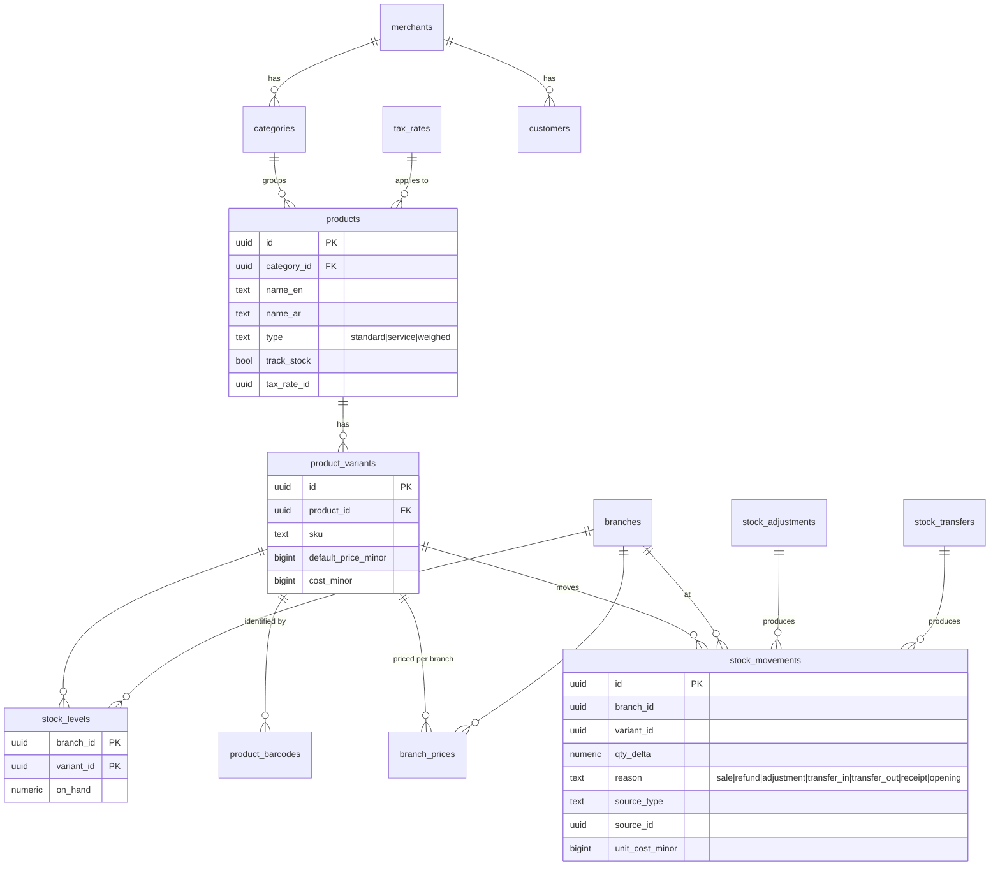
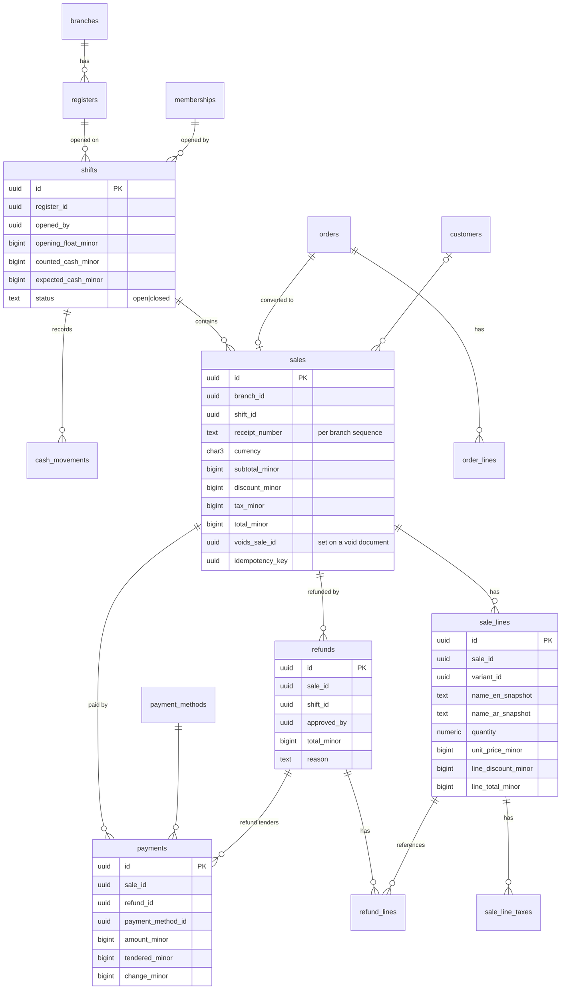

# Database

Status: **Conventions and initial entity design defined. No migrations exist yet.**
The tenant is called **merchant** in the schema (`merchant_id`).

---

## 1. Engine and access
- PostgreSQL **18.x** in all environments (local Docker image `postgres:18`).
  Until CI is pinned, schema must also run on PostgreSQL 16+ (the cloud sandbox
  has 16) — so no reliance on PG18-only features (UUIDv7 is generated in the
  application, not with PG18 `uuidv7()`).
- Access via Drizzle ORM + node-postgres. Schema changes **only** through
  versioned SQL migrations in the repo (drizzle-kit generate → hand review).
- Roles:
  - `app_owner` — owns schema objects, runs migrations.
  - `app_runtime` — used by the API: DML only, **no superuser, no `BYPASSRLS`**.

## 2. Naming & column conventions
- `snake_case`, plural table names.
- PK `id uuid` (UUIDv7, time-ordered → index-friendly).
- FK `<entity>_id`; merchant-owned children use composite FKs
  `(merchant_id, <entity>_id) → parent(merchant_id, id)`; every merchant table
  has `unique (merchant_id, id)` to support this.
- `created_at timestamptz not null default now()`, `updated_at` on mutable rows,
  `created_by` / `updated_by` (membership or operator id) where relevant.
- `version int not null default 1` on editable master data (optimistic locking).
- Status enums as `text` + `check` constraints (easier migrations than PG enums).
- Bilingual display names: `name_en text`, `name_ar text`,
  `check (coalesce(name_en, name_ar) is not null)`.

## 3. Multi-tenancy
- Every merchant-owned table: `merchant_id uuid not null`.
- RLS on every such table:
  ```sql
  alter table <t> enable row level security;
  alter table <t> force row level security;
  create policy merchant_isolation on <t>
    using (merchant_id = current_setting('app.merchant_id', true)::uuid)
    with check (merchant_id = current_setting('app.merchant_id', true)::uuid);
  ```
  `app.merchant_id` is set per transaction with `SET LOCAL` by the kernel's
  `withMerchantTx()`. When it is unset, no rows are visible.
- Unique business keys are scoped: `unique (merchant_id, sku)` etc.
- Global tables (no RLS, accessed only by specific modules): `users`,
  `sessions`, `platform_operators`, `plans`, `plan_features`, `currencies`.
  `merchants` itself is readable through a policy on `id = app.merchant_id` and
  through the platform module's audited path.

## 4. Money, quantities, rates
- Money: `bigint` minor units + `currency char(3)`. KWD = 3 decimals
  (1.250 KWD → `1250`). Columns suffixed `_minor` (e.g. `total_minor`).
- Forbidden types for money: `real`, `double precision`, `money`. Money is never
  converted to a JS `number`.
- `currencies (code, exponent, name_en, name_ar)` reference table (KWD=3).
- Quantities: `numeric(18,3)`; handled with decimal.js in TS.
- Rates: `numeric(9,6)` as a fraction (e.g. `0.050000` = 5%) or basis points —
  documented per column.

## 5. Append-only rules
- Insert-only tables: `sales`, `sale_lines`, `sale_line_taxes`, `payments`,
  `refunds`, `refund_lines`, `stock_movements`, `cash_movements`,
  `audit_log`, `goods_receipt_lines`.
- Enforced by: no UPDATE/DELETE grants for `app_runtime` on these tables
  (status columns that must change, e.g. `sales.status = voided`, are avoided by
  storing voids as separate rows referencing the sale).
- `stock_levels` is a cached balance updated in the **same transaction** as the
  movement; it can always be rebuilt from `stock_movements`.

## 6. Entity relationship design

### 6.1 Identity, organization and access (Milestone M1)


Key constraints:
- `unique (merchant_id, user_id)` on memberships;
  `unique (merchant_id) where is_owner` (exactly one owner, enforced together
  with creation logic).
- `unique (merchant_id, name)` on roles; `unique (membership_id, role_id, branch_id)`
  with `NULLS NOT DISTINCT` semantics for assignments.
- `unique (merchant_id, code)` on branches.

### 6.2 Catalog, inventory, customers (M2–M3)



Every product has at least one variant (simple products have exactly one), so
sales, stock and prices always reference `product_variants`.

### 6.3 Registers, shifts, orders, sales, payments, refunds (M4–M5)



- Sale lines **snapshot** names, prices and tax so historic receipts never
  change when the catalog changes.
- Receipt numbers: gap-free per branch via `receipt_sequences`
  (row lock in the sale transaction).
- `sales.idempotency_key` unique per merchant.

### 6.4 Later modules (entities only; designed in detail when scheduled)
| Module | Entities |
|---|---|
| purchasing | `suppliers`, `purchase_orders`, `purchase_order_lines`, `goods_receipts`, `goods_receipt_lines` |
| restaurant | `dining_areas`, `dining_tables`, `modifier_groups`, `modifiers`, `order_line_modifiers`, `kitchen_tickets` |
| ecommerce | `online_stores`, `channel_listings` (+ `orders.channel = 'online'`) |
| reporting | `daily_sales_summary` (branch, date, totals) and SQL views |
| subscriptions | `plans`, `plan_features`, `subscriptions` (already in 6.1) |
| idempotency | `idempotency_keys (merchant_id, key, request_hash, response, expires_at)` |
| outbox | `outbox_events` (when async delivery is first needed) |

## 7. Indexing guidelines
- Every merchant table: indexes lead with `merchant_id`.
- Time-series tables (`sales`, `stock_movements`, `audit_log`):
  `(merchant_id, branch_id, created_at desc)`; designed so time partitioning
  can be added without changing application code.
- Barcode lookup: `unique (merchant_id, barcode)`.

## 8. Migration workflow
1. Change the Drizzle schema in the owning module (`modules/<m>/infrastructure/schema.ts`).
2. `pnpm db:generate` → review SQL by hand; add RLS policies, grants, checks.
3. `pnpm db:migrate` locally; run integration tests incl. isolation tests.
4. Commit schema + migration together. **Never edit an applied migration.**
5. Production changes follow expand → migrate data → contract.
