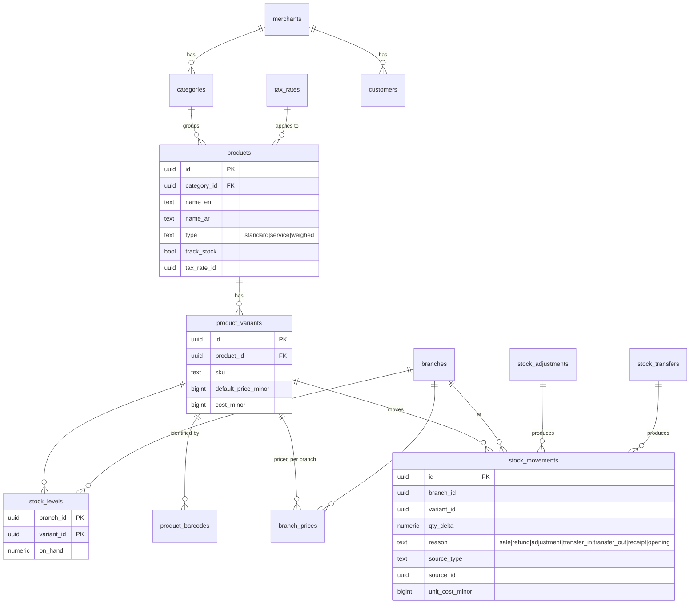
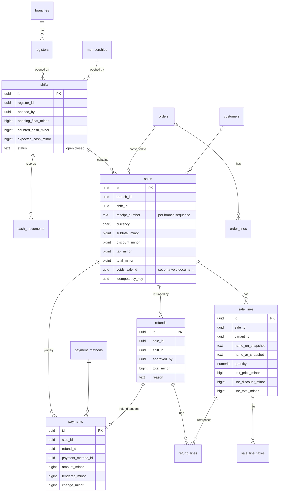

# Database

Status: **Identity tables implemented (Prompt 4).** Later modules are added per slice.
The tenant is called **merchant** in the schema (`merchant_id`).

---

## 1. Engine and access
- PostgreSQL **18.x** in all environments (local Docker image `postgres:18`, CI
  service `postgres:18`). UUIDv7 is generated in the application.
- Access via Drizzle ORM + node-postgres. Schema changes **only** through
  versioned SQL migrations in the repo (drizzle-kit generate → hand review).
- Roles:
  - `app_owner` — owns schema objects, runs migrations.
  - `app_runtime` — used by the API: DML only, **no superuser, no `BYPASSRLS`**.

## 2. Naming & column conventions
- `snake_case`, plural table names.
- PK `id uuid` (UUIDv7, time-ordered → index-friendly).
- FK `<entity>_id`; merchant-owned children use composite FKs
  `(merchant_id, <entity>_id) → parent(merchant_id, id)`; every merchant table
  has `unique (merchant_id, id)` to support this.
- `created_at timestamptz not null default now()`, `updated_at` on mutable rows,
  `created_by` / `updated_by` (membership or operator id) where relevant.
- `version int not null default 1` on editable master data (optimistic locking).
- Status enums as `text` + `check` constraints (easier migrations than PG enums).
- Bilingual display names: `name_en text`, `name_ar text`,
  `check (coalesce(name_en, name_ar) is not null)`.

## 3. Multi-tenancy
- Every merchant-owned table: `merchant_id uuid not null`.
- RLS on every such table:
  ```sql
  alter table <t> enable row level security;
  alter table <t> force row level security;
  create policy merchant_isolation on <t>
    using (merchant_id = app_current_merchant_id())
    with check (merchant_id = app_current_merchant_id());
  ```
  `app.merchant_id` is set per transaction with `SET LOCAL` by the kernel's
  `withMerchantTx()`. When it is unset, no rows are visible.
- Unique business keys are scoped: `unique (merchant_id, sku)` etc.
- Global tables (no RLS, accessed only by specific modules): `users`,
  `sessions`, `platform_operators`, `plans`, `plan_features`, `currencies`.
  `merchants` itself is readable through a policy on `id = app.merchant_id` and
  through the platform module's audited path.

## 4. Money, quantities, rates
- Money: `bigint` minor units + `currency char(3)`. KWD = 3 decimals
  (1.250 KWD → `1250`). Columns suffixed `_minor` (e.g. `total_minor`).
- Forbidden types for money: `real`, `double precision`, `money`. Money is never
  converted to a JS `number`.
- `currencies (code, exponent, name_en, name_ar)` reference table (KWD=3).
- Quantities: `numeric(18,3)`; handled with decimal.js in TS.
- Rates: `numeric(9,6)` as a fraction (e.g. `0.050000` = 5%) or basis points —
  documented per column.

## 5. Append-only rules
- Insert-only tables: `sales`, `sale_lines`, `sale_line_taxes`, `payments`,
  `refunds`, `refund_lines`, `stock_movements`, `cash_movements`,
  `audit_log`, `goods_receipt_lines`.
- Enforced by: no UPDATE/DELETE grants for `app_runtime` on these tables
  (status columns that must change, e.g. `sales.status = voided`, are avoided by
  storing voids as separate rows referencing the sale).
- `stock_levels` is a cached balance updated in the **same transaction** as the
  movement; it can always be rebuilt from `stock_movements`.

## 6. Entity relationship design

### 6.1 Identity, organization and access (Milestone M1)


Key constraints:
- `unique (merchant_id, user_id)` on memberships;
  `unique (merchant_id) where is_owner` (exactly one owner, enforced together
  with creation logic).
- `unique (merchant_id, name)` on roles; `unique (membership_id, role_id, branch_id)`
  with `NULLS NOT DISTINCT` semantics for assignments.
- `unique (merchant_id, code)` on branches.

### 6.2 Catalog, inventory, customers (M2–M3)



Every product has at least one variant (simple products have exactly one), so
sales, stock and prices always reference `product_variants`.

### 6.3 Registers, shifts, orders, sales, payments, refunds (M4–M5)



- Sale lines **snapshot** names, prices and tax so historic receipts never
  change when the catalog changes.
- Receipt numbers: gap-free per branch via `receipt_sequences`
  (row lock in the sale transaction).
- `sales.idempotency_key` unique per merchant.

### 6.4 Later modules (entities only; designed in detail when scheduled)
| Module | Entities |
|---|---|
| purchasing | `suppliers`, `purchase_orders`, `purchase_order_lines`, `goods_receipts`, `goods_receipt_lines` |
| restaurant | `dining_areas`, `dining_tables`, `modifier_groups`, `modifiers`, `order_line_modifiers`, `kitchen_tickets` |
| ecommerce | `online_stores`, `channel_listings` (+ `orders.channel = 'online'`) |
| reporting | `daily_sales_summary` (branch, date, totals) and SQL views |
| subscriptions | `plans`, `plan_features`, `subscriptions` (already in 6.1) |
| idempotency | `idempotency_keys (merchant_id, key, request_hash, response, expires_at)` |
| outbox | `outbox_events` (when async delivery is first needed) |

## 7. Indexing guidelines
- Every merchant table: indexes lead with `merchant_id`.
- Time-series tables (`sales`, `stock_movements`, `audit_log`):
  `(merchant_id, branch_id, created_at desc)`; designed so time partitioning
  can be added without changing application code.
- Barcode lookup: `unique (merchant_id, barcode)`.

## 8. Implemented migrations

| File | Content |
|---|---|
| `apps/api/drizzle/0000_bootstrap.sql` | `GRANT USAGE` on schema to `app_runtime`; default privileges (DML on tables, sequences, functions) for objects created by `app_owner`; function `app_current_merchant_id()` (NULL when unset) for RLS policies |
| `apps/api/drizzle/0001_currencies.sql` | `currencies` reference table (code, exponent, `name_en`, `name_ar`); `app_runtime` is read-only on it |
| `apps/api/drizzle/0002_identity.sql` | `merchants`, `branches`, `users`, `memberships`, `roles`, `role_permissions`, `role_assignments`, `sessions`, `auth_tickets`, `password_reset_tokens`, `rate_limit_buckets`, `platform_operators`, `audit_log` (generated) |
| `apps/api/drizzle/0003_identity_rls.sql` | `app_current_user_id()`; RLS (forced) on merchants, memberships, branches, roles, role_permissions, role_assignments, audit_log; `DELETE` revoked on merchants; `UPDATE/DELETE` revoked on audit_log; lookup indexes |

| `apps/api/drizzle/0004_employees.sql` | `invitations`, `invitation_assignments`; branch settings (`phone`, `address`, `receipt_header`, `receipt_footer`); employee profile on memberships (`job_title`, `phone`, `employee_code`) |
| `apps/api/drizzle/0005_employees_rls.sql` | `app_current_invite_hash()`; RLS on invitations (merchant context or matching invite token hash) and invitation_assignments; data migration of renamed permission keys and `manager` → `company_manager` |

| `apps/api/drizzle/0006_catalog.sql` | `categories` (self-referencing tree), `products`, `product_variants` (`price_minor`/`cost_minor` bigint, currency), `product_barcodes`, `product_branch_availability`, `product_images` |
| `apps/api/drizzle/0007_catalog_rls.sql` | Forced RLS on all catalog tables; `DELETE` revoked on products and variants (archive only); `pg_trgm` + trigram indexes on names and SKU |

| `apps/api/drizzle/0008_inventory.sql` | `inventory_settings`, `stock_levels`, `stock_adjustments`, `stock_adjustment_lines`, `stock_movements` (generated) |
| `apps/api/drizzle/0009_inventory_rls.sql` | Forced RLS on all inventory tables; `UPDATE/DELETE` revoked on the ledger and adjustment documents; `DELETE` revoked on `stock_levels` |

Inventory model notes (implemented, Prompt 8):
- Quantities are `numeric(14,3)` (exact thousandths, e.g. kg); the API exchanges them as
  decimal strings and the code computes with bigint milli-units (`@arabat/money` quantity
  helpers). Never floats.
- `stock_movements` is the append-only ledger: signed `quantity`, `balance_after`,
  `unit_cost_minor`, `value_minor`, `avg_cost_after_minor`, `movement_type`
  (opening, adjustment, count, sale, sale_void, refund, transfer_out, transfer_in,
  purchase_receipt), `source_type`/`source_id` of the originating document and the user.
- `stock_levels` (PK merchant, branch, variant) holds the current balance, the moving
  weighted-average cost and the optional low-stock threshold. It only changes together
  with a ledger row, under `SELECT … FOR UPDATE` taken in variant-id order (no lost
  updates, no deadlocks). Invariant (tested): `on_hand = sum(movements.quantity)`.
- `stock_adjustments` + `_lines` are manual documents (opening, increase, decrease,
  count) with reason, note, author and an optional idempotency key
  (`unique (merchant_id, idempotency_key)` + request hash).
- `inventory_settings.allow_negative_stock` (default false) is the oversell policy.

Catalog model notes (implemented, Prompt 7):
- Every product has at least one variant; a simple product has exactly one (the
  default). Prices and costs live on variants as integer fils (`bigint`), with a
  `currency` column (KWD).
- SKU: unique per merchant, case-insensitive (`unique (merchant_id, lower(sku))`),
  including archived variants, so an SKU is never silently reused.
- Barcode: primary key `(merchant_id, barcode)` — unique across all active variants of
  the merchant. Archiving a variant releases its barcodes.
- Products and variants are archived, never deleted (sales will reference them).
- `available_in_all_branches = false` restricts a product to the rows in
  `product_branch_availability`.
- Images: metadata row in `product_images`; bytes in `FileStorage` (local disk in
  development, key `merchants/<id>/products/<id>/<imageId>`); max 2 MB, 8 per product,
  type detected from magic bytes (JPEG/PNG/WebP).

Migration role: `app_owner` has **BYPASSRLS** (ADR-0031) so data migrations and
cross-merchant seeds work; owner-role scripts and test fixtures must therefore filter
by `merchant_id` explicitly. The API's `app_runtime` role never bypasses RLS.

Identity model notes (implemented):
- `users` is global (one identity, many memberships); e-mail stored lower-cased
  (`check email = lower(email)`), unique.
- `memberships`: `unique (merchant_id, user_id)`, exactly one owner per merchant
  (partial unique index), an owner membership must be active.
- `role_assignments.branch_id` NULL = all branches; `UNIQUE NULLS NOT DISTINCT
  (membership_id, role_id, branch_id)`; composite FKs `(merchant_id, …)` to
  memberships, roles and branches.
- `sessions` check constraint: a merchant session always has `merchant_id` and
  `membership_id`, a POS session always a `branch_id`; platform sessions have neither.
- Global tables without RLS (`users`, `sessions`, `auth_tickets`,
  `password_reset_tokens`, `rate_limit_buckets`, `platform_operators`) are only read
  by the auth module; token columns hold SHA-256 hashes.
- RLS read exception: with `app.user_id` set, a user sees their own memberships and
  those merchants (ADR-0029).

Seeds: `100-dev-demo-merchants` (development only) creates "Demo Store" (2 branches)
and "Second Shop", users owner/manager/cashier/multi `@demo.arabat.test` and the dev
platform operator, all with password `Demo-Pass-2026`.

Seeds (`apps/api/src/database/seeds`, run as `app_owner` in one transaction,
idempotent, each seed declares the environments it may run in):
`001-currencies` (KWD=3, BHD=3, OMR=3, SAR, AED, QAR, USD, EUR = 2) and the
development-only `100-dev-demo-merchants`.

Connection management: `DatabaseService` owns one `pg.Pool` (size
`DATABASE_POOL_MAX`, statement timeout, idle-error handler), exposes
`withTransaction()` and `withMerchantTx(merchantId)` — the latter validates the
UUID and runs `set_config('app.merchant_id', id, true)` (transaction-local). The
pool is closed on shutdown. Role/database bootstrap: `docker/postgres/init/`.

RLS policy template (verified by `database.int.test.ts`):
```sql
using (merchant_id = app_current_merchant_id())
with check (merchant_id = app_current_merchant_id())
```

## 9. Migration workflow
1. Change the Drizzle schema in the owning module (`modules/<m>/infrastructure/schema.ts`).
2. `pnpm db:generate` → review SQL by hand; add RLS policies, grants, checks.
3. `pnpm db:migrate` locally; run integration tests incl. isolation tests.
4. Commit schema + migration together. **Never edit an applied migration.**
5. Production changes follow expand → migrate data → contract.
